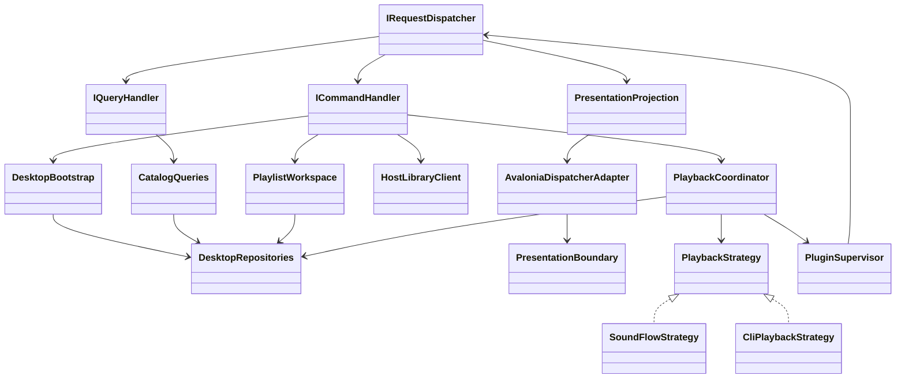
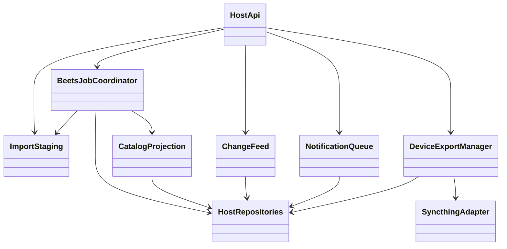

# Beets Man architecture

[Exported C4 views](views.md)

[CQRS application interfaces](cqrs.md) · [LiteDB repository design](persistence.md) · [Code structure and implementation order](code-structure.md)

[Desktop LiteDB entities](views.md#desktoplitedbentities) · [Host LiteDB entities](views.md#hostlitedbentities)

[Structurizr workspace](workspace.dsl) is the canonical draft for system context, containers, desktop and host component views, deployment, and dynamic flows. Reconcile this file, diagram exports, code views, and decisions in each architectural change. Use the pinned `structurizr/structurizr:2026.09.19-noble` validator and exporter. The implementation gate must validate the DSL, regenerate exports in scratch space, and compare expected view keys and exported bytes. This is a Stage 0 design, so code names below describe intended boundaries.

## Desktop code boundaries

The UI submits typed intent. A scoped handler returns a typed result with correlation, validation and cancellation outcomes. Application-driven updates, including window mode, focus and modal changes, enter the one Avalonia dispatcher adapter. The audio callback exchanges bounded state and samples with the engine adapter and performs no logging I/O or plugin IPC. Workers contribute data and declarative controls through bounded messages; they run with the user's OS permissions.

## Host code boundaries

Beets owns source metadata and media organization. The host owns registered identities, shared defaults, catalog revisions, listening state and durable notifications. It commits projected changes and delivery state together. External beets work is journaled, executed, and reconciled rather than treated as part of a LiteDB transaction. Desktops apply each change page with its checkpoint and only then acknowledge. Offline drafts and local presentation survive authoritative snapshot replacement.

## Deployment and ownership

One configured desktop runs the host and its separate LiteDB store. Registered desktop clients use authenticated HTTPS and maintain independent LiteDB stores. Credentials use OS storage. The source music path and local playback root are separate settings; the latter resolves only local media paths. Beets configuration, both databases, logs, staging, and IPC credentials stay outside all Syncthing shares.

Syncthing distributes bytes. PC mirrors retain the source media layout. Each Android profile produces an independently owned send-only export and separately registered receive-only share. A live Android connection event schedules a CQRS navigation intent that switches the desktop to Normal Sync on the next UI dispatch. A historical event cannot change the selected presentation.

## Configuration decisions

- Bootstrap values come from local appsettings.json before storage, media or plugins start. Resolve the two template path variables at first launch. Apply changes on restart. Preserve explicit values and unknown keys during upgrades.
- Ordinary settings use local override, host default, then built-in default. Device paths, execution profiles, credential material, plugin trust, and OS registrations remain local.
- Use structured ILogger events throughout. Carry a request correlation ID between CQRS, host calls and workers, and filter by category. Keep redaction and event admission ahead of the file sink.
