# C4 views exported from Structurizr

Generated from [workspace.dsl](workspace.dsl) using the pinned 2026.09.19-noble image. The [architecture guide](README.md) contains code-level views and decisions.

## SystemContext

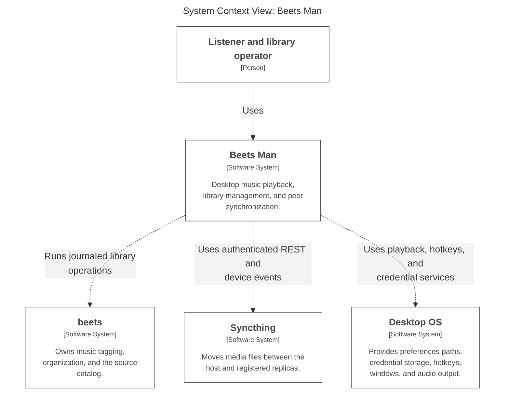

## Containers

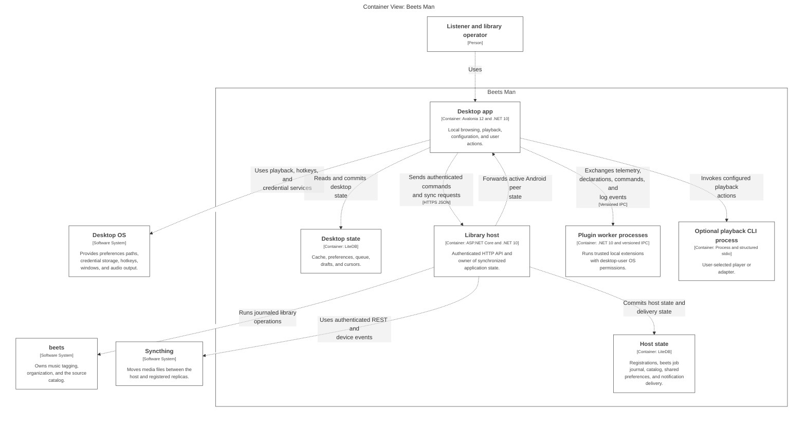

## DesktopComponents

```mermaid
graph LR
  linkStyle default fill:#ffffff

  subgraph diagram ["Component View: Beets Man - Desktop app"]
    style diagram fill:#ffffff,stroke:#ffffff

    5["<div style='font-weight: bold'>Desktop OS</div><div style='font-size: 70%; margin-top: 0px'>[Software System]</div><div style='font-size: 80%; margin-top:10px'>Provides preferences paths,<br />credential storage, hotkeys,<br />windows, and audio output.</div>"]
    style 5 fill:#ffffff,stroke:#444444,color:#444444

    subgraph 6 ["Beets Man"]
      style 6 fill:#ffffff,stroke:#444444,color:#444444

      subgraph 7 ["Desktop app"]
        style 7 fill:#ffffff,stroke:#444444,color:#444444

        10["<div style='font-weight: bold'>Presentation projection</div><div style='font-size: 70%; margin-top: 0px'>[Component]</div><div style='font-size: 80%; margin-top:10px'>Guards owner scope and<br />revision, shares playback<br />state, and exposes logical<br />interaction blocking<br />independently of background<br />progress.</div>"]
        style 10 fill:#ffffff,stroke:#444444,color:#444444
        11["<div style='font-weight: bold'>CQRS and Unit of Work</div><div style='font-size: 70%; margin-top: 0px'>[Component]</div><div style='font-size: 80%; margin-top:10px'>Dispatches typed commands and<br />queries to exactly one<br />handler and returns a typed<br />outcome. Coordinates writes<br />by state owner.</div>"]
        style 11 fill:#ffffff,stroke:#444444,color:#444444
        12["<div style='font-weight: bold'>Desktop bootstrap</div><div style='font-size: 70%; margin-top: 0px'>[Component]</div><div style='font-size: 80%; margin-top:10px'>Validates local configuration<br />and resolves paths before<br />opening desktop state.<br />Reports initialization,<br />repair, or ready state.</div>"]
        style 12 fill:#ffffff,stroke:#444444,color:#444444
        13["<div style='font-weight: bold'>Local configuration and settings</div><div style='font-size: 70%; margin-top: 0px'>[Component]</div><div style='font-size: 80%; margin-top:10px'>Loads appsettings.json and<br />resolves preference<br />precedence.</div>"]
        style 13 fill:#ffffff,stroke:#444444,color:#444444
        14["<div style='font-weight: bold'>Catalog queries</div><div style='font-size: 70%; margin-top: 0px'>[Component]</div><div style='font-size: 80%; margin-top:10px'>Reads indexed Library<br />projections and reports track<br />availability under the local<br />music root.</div>"]
        style 14 fill:#ffffff,stroke:#444444,color:#444444
        15["<div style='font-weight: bold'>Playlist workspace</div><div style='font-size: 70%; margin-top: 0px'>[Component]</div><div style='font-size: 80%; margin-top:10px'>Maintains ordered drafts and<br />saves named playlists. Copies<br />the current queue into a<br />draft when requested.</div>"]
        style 15 fill:#ffffff,stroke:#444444,color:#444444
        16["<div style='font-weight: bold'>Playback coordinator</div><div style='font-size: 70%; margin-top: 0px'>[Component]</div><div style='font-size: 80%; margin-top:10px'>Owns the active queue and one<br />playback session across<br />views, transport and two<br />independently cueable decks.</div>"]
        style 16 fill:#ffffff,stroke:#444444,color:#444444
        17["<div style='font-weight: bold'>SoundFlow strategy</div><div style='font-size: 70%; margin-top: 0px'>[Component]</div><div style='font-size: 80%; margin-top:10px'>Mixes decks, applies EQ, and<br />produces audio telemetry.</div>"]
        style 17 fill:#ffffff,stroke:#444444,color:#444444
        18["<div style='font-weight: bold'>External CLI strategy</div><div style='font-size: 70%; margin-top: 0px'>[Component]</div><div style='font-size: 80%; margin-top:10px'>Translates YAML actions into<br />command or session protocol<br />calls.</div>"]
        style 18 fill:#ffffff,stroke:#444444,color:#444444
        19["<div style='font-weight: bold'>Plugin supervisor</div><div style='font-size: 70%; margin-top: 0px'>[Component]</div><div style='font-size: 80%; margin-top:10px'>Manages local trust, worker<br />IPC, and declarative<br />contributions.</div>"]
        style 19 fill:#ffffff,stroke:#444444,color:#444444
        20["<div style='font-weight: bold'>Host library client</div><div style='font-size: 70%; margin-top: 0px'>[Component]</div><div style='font-size: 80%; margin-top:10px'>Submits authenticated import<br />and tag commands, preserves<br />edit drafts, and observes<br />asynchronous job status.</div>"]
        style 20 fill:#ffffff,stroke:#444444,color:#444444
        21["<div style='font-weight: bold'>Record sync client</div><div style='font-size: 70%; margin-top: 0px'>[Component]</div><div style='font-size: 80%; margin-top:10px'>Applies snapshots and<br />revisions, replays edits, and<br />acknowledges notifications.</div>"]
        style 21 fill:#ffffff,stroke:#444444,color:#444444
        22["<div style='font-weight: bold'>Desktop repositories</div><div style='font-size: 70%; margin-top: 0px'>[Component: LiteDB adapter]</div><div style='font-size: 80%; margin-top:10px'>Maps owned desktop state and<br />materialized catalog queries<br />to local LiteDB collections.<br />Runs atomic local writes.</div>"]
        style 22 fill:#ffffff,stroke:#444444,color:#444444
        23["<div style='font-weight: bold'>Logging adapter</div><div style='font-size: 70%; margin-top: 0px'>[Component]</div><div style='font-size: 80%; margin-top:10px'>ILogger scopes, local<br />filters, rolling retention,<br />and redaction.</div>"]
        style 23 fill:#ffffff,stroke:#444444,color:#444444
        8["<div style='font-weight: bold'>Presentation boundary</div><div style='font-size: 70%; margin-top: 0px'>[Component]</div><div style='font-size: 80%; margin-top:10px'>Avalonia binds MVVM Toolkit<br />ViewModels, typed CQRS<br />commands, and system wait<br />cursor state for logically<br />blocked scopes.</div>"]
        style 8 fill:#ffffff,stroke:#444444,color:#444444
        9["<div style='font-weight: bold'>Avalonia dispatcher adapter</div><div style='font-size: 70%; margin-top: 0px'>[Component]</div><div style='font-size: 80%; margin-top:10px'>Applies all<br />application-driven<br />presentation updates on<br />UIThread.</div>"]
        style 9 fill:#ffffff,stroke:#444444,color:#444444
      end

      24["<div style='font-weight: bold'>Desktop state</div><div style='font-size: 70%; margin-top: 0px'>[Container: LiteDB]</div><div style='font-size: 80%; margin-top:10px'>Cache, preferences, queue,<br />drafts, and cursors.</div>"]
      style 24 fill:#ffffff,stroke:#444444,color:#444444
      25["<div style='font-weight: bold'>Library host</div><div style='font-size: 70%; margin-top: 0px'>[Container: ASP.NET Core and .NET 10]</div><div style='font-size: 80%; margin-top:10px'>Authenticated HTTP API and<br />owner of synchronized<br />application state.</div>"]
      style 25 fill:#ffffff,stroke:#444444,color:#444444
      35["<div style='font-weight: bold'>Plugin worker processes</div><div style='font-size: 70%; margin-top: 0px'>[Container: .NET 10 and versioned IPC]</div><div style='font-size: 80%; margin-top:10px'>Runs trusted local extensions<br />with desktop-user OS<br />permissions.</div>"]
      style 35 fill:#ffffff,stroke:#444444,color:#444444
      36["<div style='font-weight: bold'>Optional playback CLI process</div><div style='font-size: 70%; margin-top: 0px'>[Container: Process and structured stdio]</div><div style='font-size: 80%; margin-top:10px'>User-selected player or<br />adapter.</div>"]
      style 36 fill:#ffffff,stroke:#444444,color:#444444
    end

    8-. "<div>Submits typed intent</div><div style='font-size: 70%'></div>" .->11
    11-. "<div>Validates and applies desktop<br />bootstrap actions</div><div style='font-size: 70%'></div>" .->12
    12-. "<div>Resolves effective paths and<br />startup configuration</div><div style='font-size: 70%'></div>" .->13
    12-. "<div>Opens the validated desktop<br />store</div><div style='font-size: 70%'></div>" .->22
    22-. "<div>Queries collections and<br />commits local transactions</div><div style='font-size: 70%'></div>" .->24
    11-. "<div>Resolves preferences</div><div style='font-size: 70%'></div>" .->13
    11-. "<div>Queries Library views and<br />validates playable selections</div><div style='font-size: 70%'></div>" .->14
    14-. "<div>Reads indexed catalog and<br />availability projections</div><div style='font-size: 70%'></div>" .->22
    11-. "<div>Starts a draft, changes<br />order, or saves a playlist</div><div style='font-size: 70%'></div>" .->15
    15-. "<div>Stores the draft and<br />operation identity</div><div style='font-size: 70%'></div>" .->22
    15-. "<div>Hands off saved playlist<br />changes for replication</div><div style='font-size: 70%'></div>" .->21
    15-. "<div>Reads the current queue<br />snapshot for Save as playlist</div><div style='font-size: 70%'></div>" .->16
    11-. "<div>Executes transport and mixer<br />actions</div><div style='font-size: 70%'></div>" .->16
    16-. "<div>Restores and commits the<br />current queue</div><div style='font-size: 70%'></div>" .->22
    11-. "<div>Submits host commands or<br />requests current job state</div><div style='font-size: 70%'></div>" .->20
    20-. "<div>Uploads copies, submits typed<br />commands, and reads job<br />status</div><div style='font-size: 70%'>[HTTPS JSON and streamed files]</div>" .->25
    11-. "<div>Publishes typed outcomes</div><div style='font-size: 70%'></div>" .->10
    10-. "<div>Schedules immutable UI update</div><div style='font-size: 70%'></div>" .->9
    9-. "<div>Applies state on UIThread</div><div style='font-size: 70%'></div>" .->8
    13-. "<div>Reads and writes local<br />preference overrides</div><div style='font-size: 70%'></div>" .->22
    13-. "<div>Configures log levels and<br />sinks</div><div style='font-size: 70%'></div>" .->23
    11-. "<div>Logs outcomes within<br />correlation scopes</div><div style='font-size: 70%'></div>" .->23
    16-. "<div>Executes built-in playback</div><div style='font-size: 70%'></div>" .->17
    16-. "<div>Executes optional CLI<br />playback</div><div style='font-size: 70%'></div>" .->18
    17-. "<div>Outputs mixed audio</div><div style='font-size: 70%'></div>" .->5
    18-. "<div>Invokes direct arguments or<br />sends stdio requests</div><div style='font-size: 70%'></div>" .->36
    16-. "<div>Publishes bounded<br />visualization telemetry</div><div style='font-size: 70%'></div>" .->19
    19-. "<div>Exchanges validated IPC</div><div style='font-size: 70%'></div>" .->35
    19-. "<div>Submits extension intents and<br />status</div><div style='font-size: 70%'></div>" .->11
    19-. "<div>Forwards worker diagnostics</div><div style='font-size: 70%'></div>" .->23
    11-. "<div>Starts record operations</div><div style='font-size: 70%'></div>" .->21
    21-. "<div>Commits applied pages and<br />checkpoints</div><div style='font-size: 70%'></div>" .->22
    21-. "<div>Registers, fetches changes<br />and acknowledges</div><div style='font-size: 70%'></div>" .->25
    25-. "<div>Forwards active Android peer<br />state</div><div style='font-size: 70%'></div>" .->21
    21-. "<div>Reports sync and peer events</div><div style='font-size: 70%'></div>" .->11

  end
```

## HostComponents

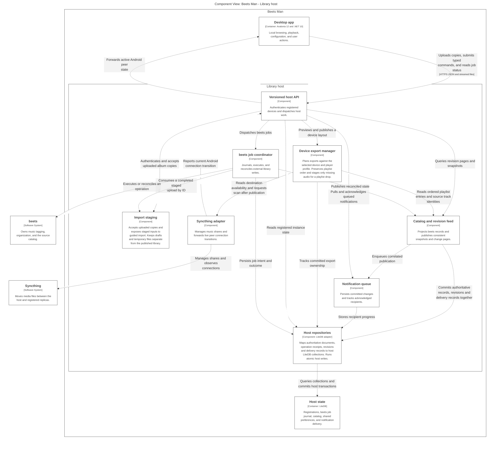

## DesktopLiteDbEntities

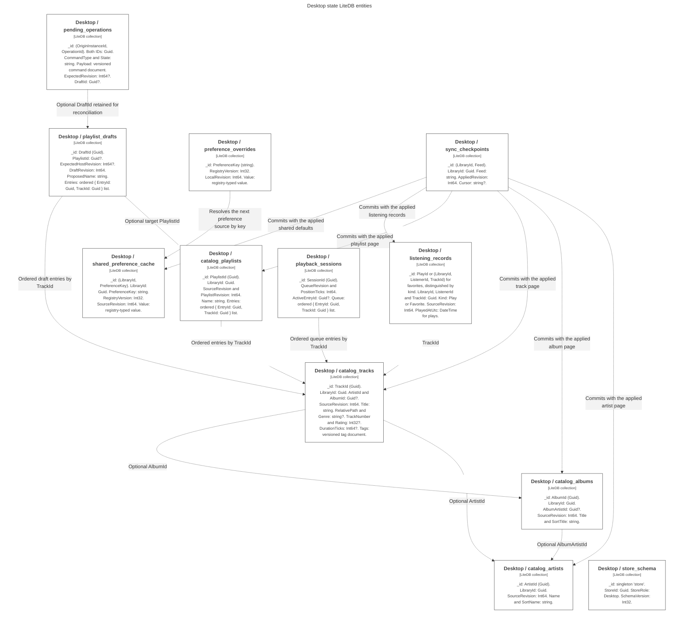

## HostLiteDbEntities

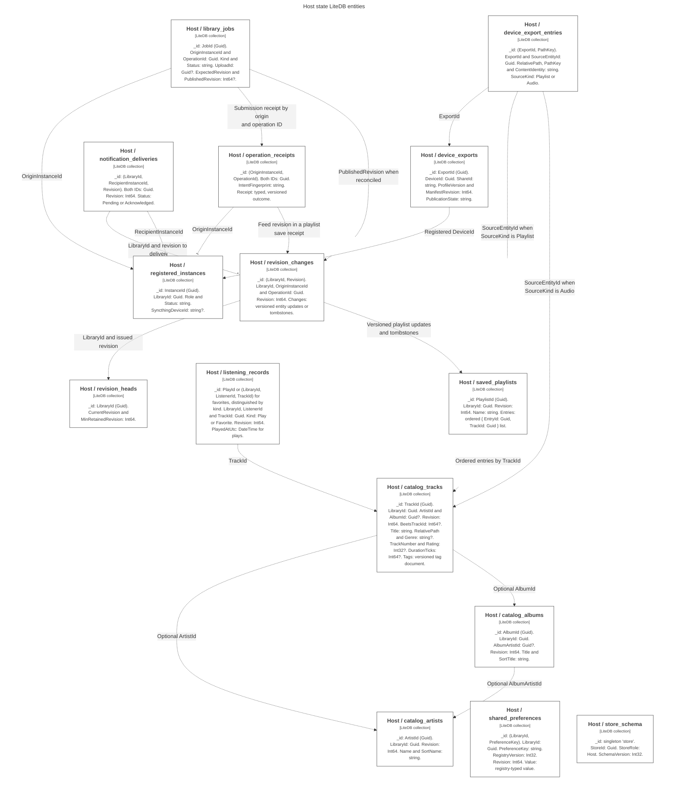

## SelfHosted

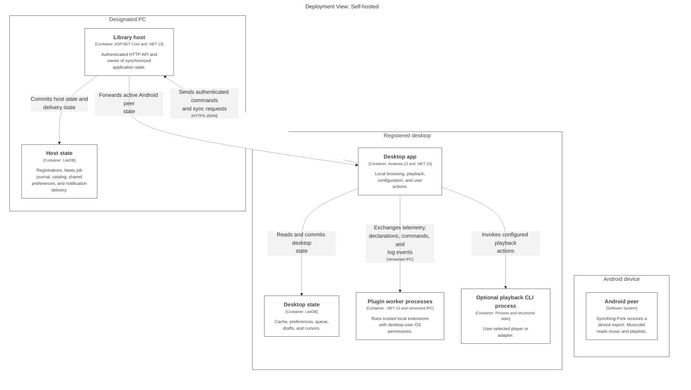

## BootstrapDispatch

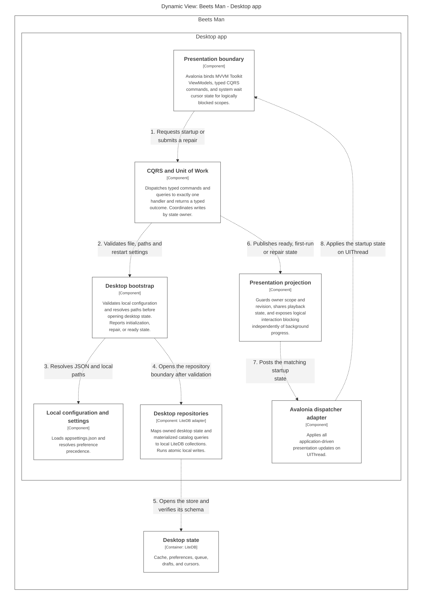

## LibraryWorkspace

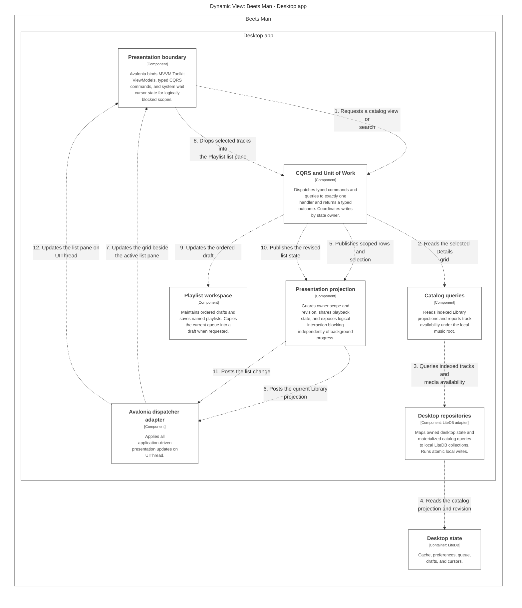

## GuidedImport

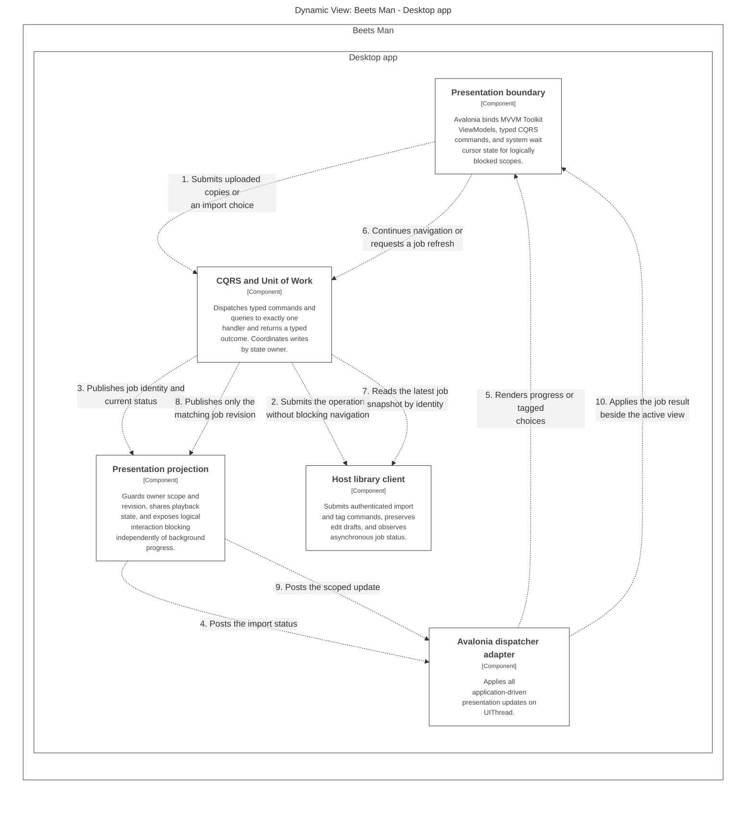

## PlaybackDispatch

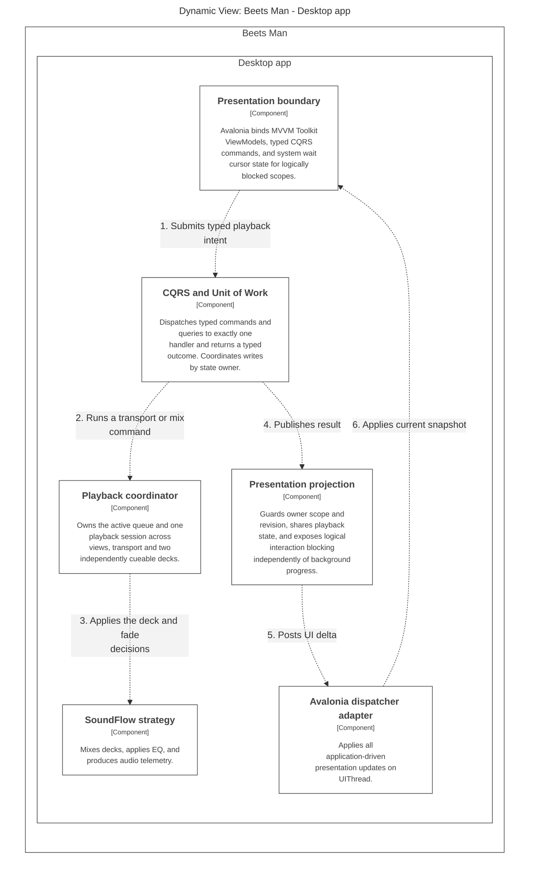

## HostPublication

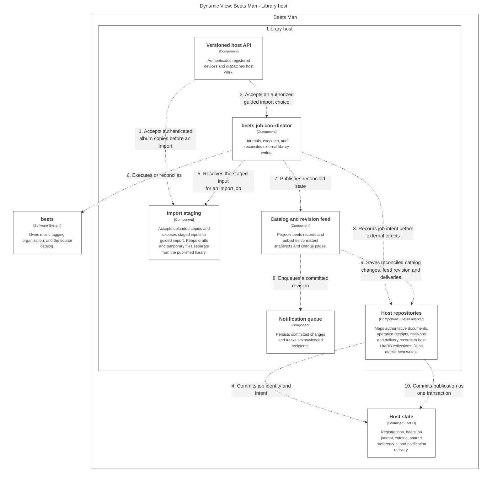

## AndroidArrival

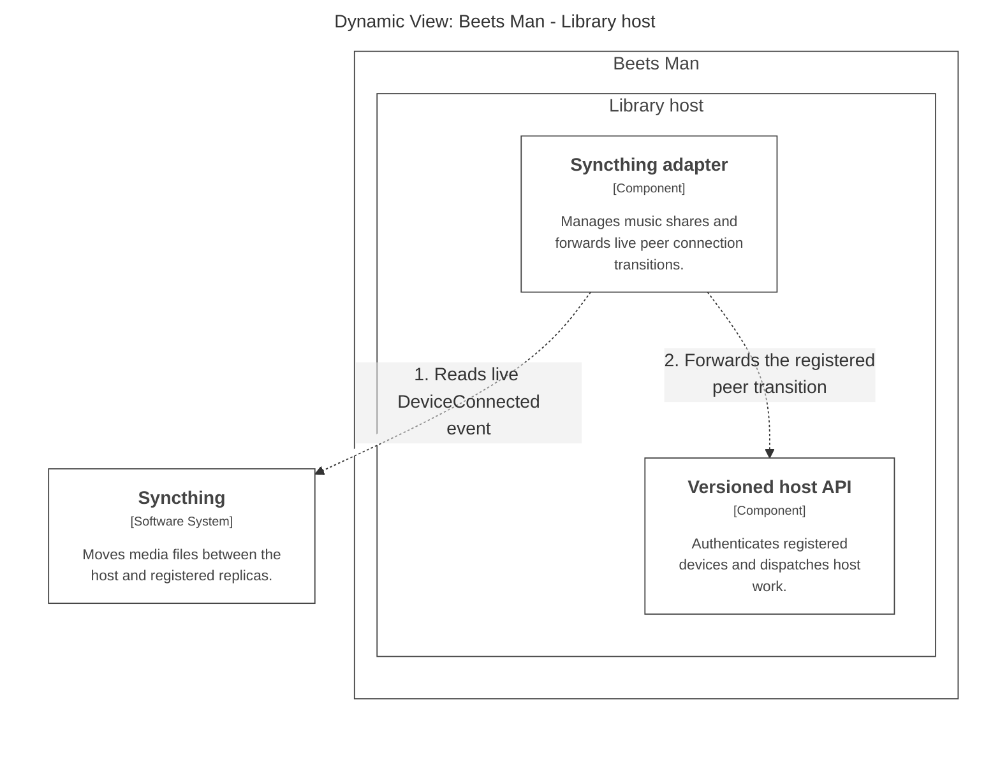
