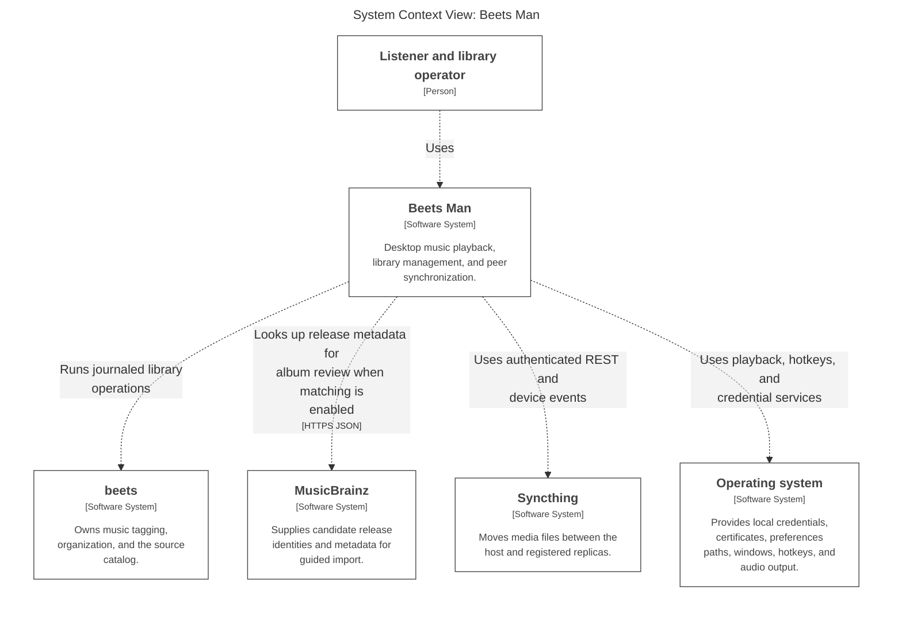
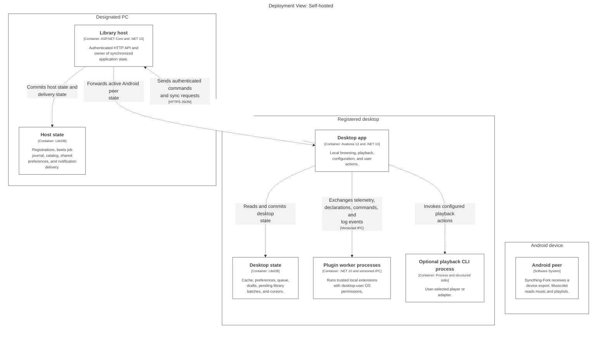
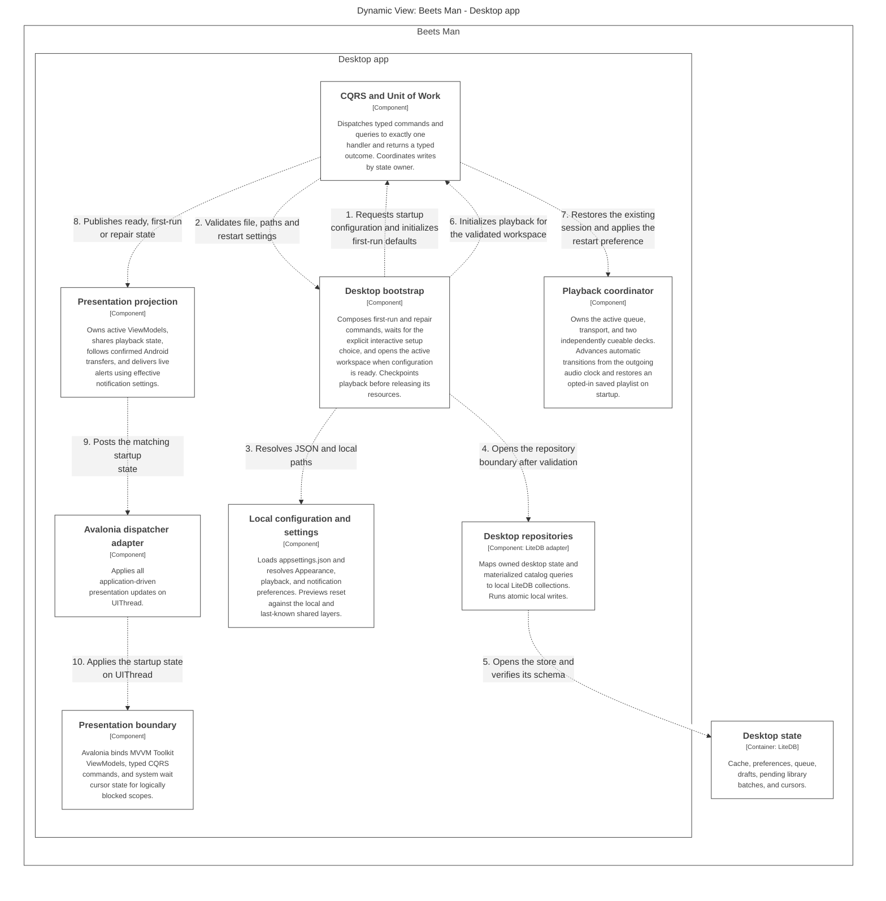
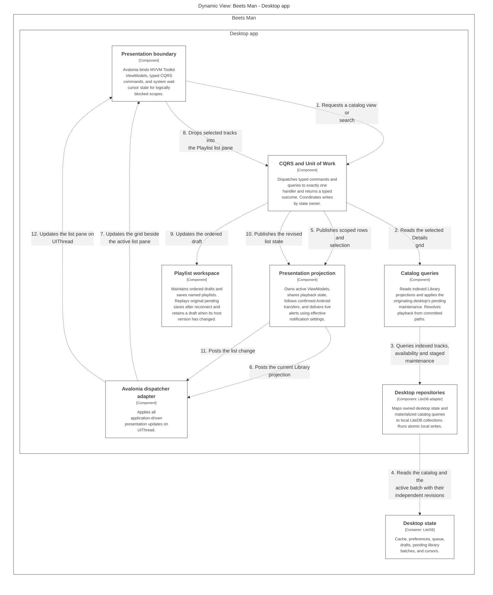
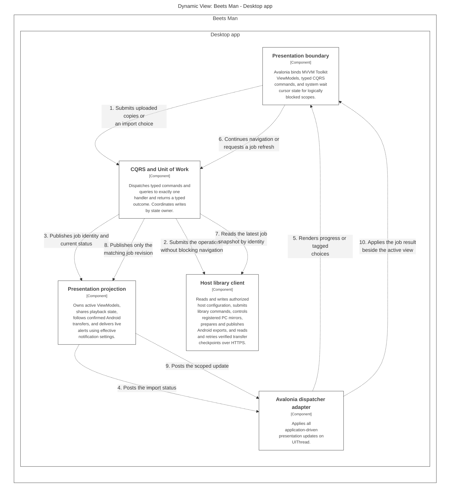
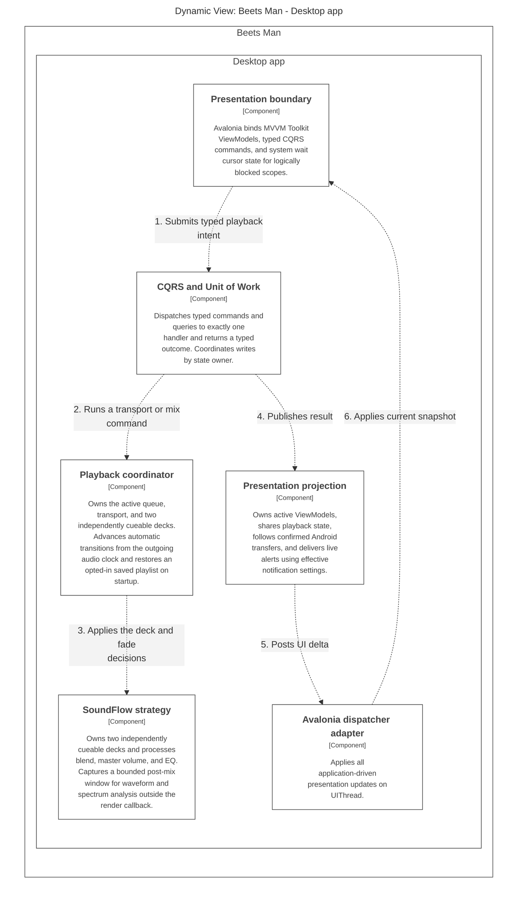
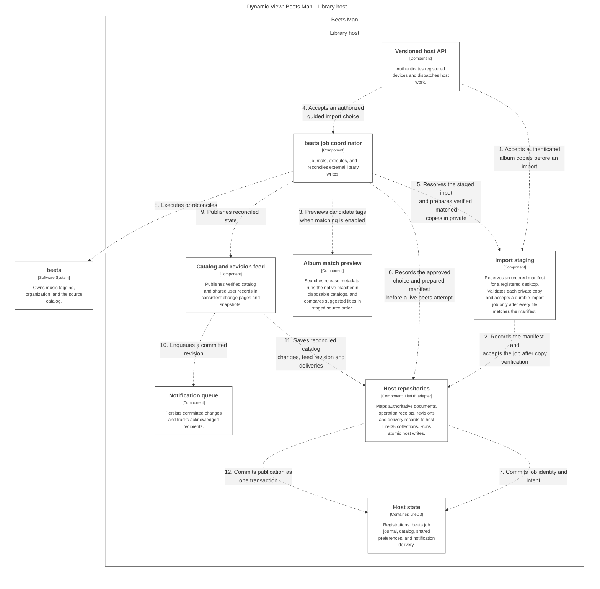
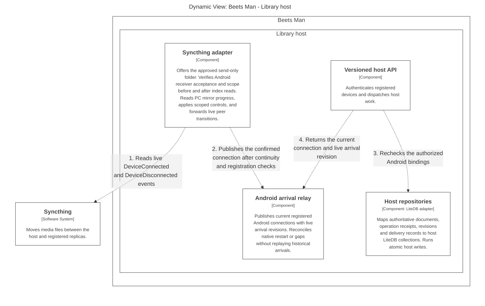

# C4 views exported from Structurizr

Generated from [workspace.dsl](workspace.dsl) using the pinned 2026.09.19-noble image. The [architecture guide](README.md) contains code-level views and decisions.

## SystemContext



## Containers

```mermaid
graph LR
  linkStyle default fill:#ffffff

  subgraph diagram ["Container View: Beets Man"]
    style diagram fill:#ffffff,stroke:#ffffff

    1["<div style='font-weight: bold'>Listener and library operator</div><div style='font-size: 70%; margin-top: 0px'>[Person]</div>"]
    style 1 fill:#ffffff,stroke:#444444,color:#444444
    2["<div style='font-weight: bold'>beets</div><div style='font-size: 70%; margin-top: 0px'>[Software System]</div><div style='font-size: 80%; margin-top:10px'>Owns music tagging,<br />organization, and the source<br />catalog.</div>"]
    style 2 fill:#ffffff,stroke:#444444,color:#444444
    3["<div style='font-weight: bold'>MusicBrainz</div><div style='font-size: 70%; margin-top: 0px'>[Software System]</div><div style='font-size: 80%; margin-top:10px'>Supplies candidate release<br />identities and metadata for<br />guided import.</div>"]
    style 3 fill:#ffffff,stroke:#444444,color:#444444
    4["<div style='font-weight: bold'>Syncthing</div><div style='font-size: 70%; margin-top: 0px'>[Software System]</div><div style='font-size: 80%; margin-top:10px'>Moves media files between the<br />host and registered replicas.</div>"]
    style 4 fill:#ffffff,stroke:#444444,color:#444444
    6["<div style='font-weight: bold'>Operating system</div><div style='font-size: 70%; margin-top: 0px'>[Software System]</div><div style='font-size: 80%; margin-top:10px'>Provides local credentials,<br />certificates, preferences<br />paths, windows, hotkeys, and<br />audio output.</div>"]
    style 6 fill:#ffffff,stroke:#444444,color:#444444

    subgraph 7 ["Beets Man"]
      style 7 fill:#ffffff,stroke:#444444,color:#444444

      38["<div style='font-weight: bold'>Desktop state</div><div style='font-size: 70%; margin-top: 0px'>[Container: LiteDB]</div><div style='font-size: 80%; margin-top:10px'>Cache, preferences, queue,<br />drafts, pending library<br />batches, and cursors.</div>"]
      style 38 fill:#ffffff,stroke:#444444,color:#444444
      39["<div style='font-weight: bold'>Library host</div><div style='font-size: 70%; margin-top: 0px'>[Container: ASP.NET Core and .NET 10]</div><div style='font-size: 80%; margin-top:10px'>Authenticated HTTP API and<br />owner of synchronized<br />application state.</div>"]
      style 39 fill:#ffffff,stroke:#444444,color:#444444
      64["<div style='font-weight: bold'>Host state</div><div style='font-size: 70%; margin-top: 0px'>[Container: LiteDB]</div><div style='font-size: 80%; margin-top:10px'>Registrations, beets job<br />journal, catalog, shared<br />preferences, and notification<br />delivery.</div>"]
      style 64 fill:#ffffff,stroke:#444444,color:#444444
      65["<div style='font-weight: bold'>Plugin worker processes</div><div style='font-size: 70%; margin-top: 0px'>[Container: .NET 10 and versioned IPC]</div><div style='font-size: 80%; margin-top:10px'>Runs trusted local extensions<br />with desktop-user OS<br />permissions.</div>"]
      style 65 fill:#ffffff,stroke:#444444,color:#444444
      66["<div style='font-weight: bold'>Optional playback CLI process</div><div style='font-size: 70%; margin-top: 0px'>[Container: Process and structured stdio]</div><div style='font-size: 80%; margin-top:10px'>User-selected player or<br />adapter.</div>"]
      style 66 fill:#ffffff,stroke:#444444,color:#444444
      8["<div style='font-weight: bold'>Desktop app</div><div style='font-size: 70%; margin-top: 0px'>[Container: Avalonia 12 and .NET 10]</div><div style='font-size: 80%; margin-top:10px'>Local browsing, playback,<br />configuration, and user<br />actions.</div>"]
      style 8 fill:#ffffff,stroke:#444444,color:#444444
    end

    39-. "<div>Forwards active Android peer<br />state</div><div style='font-size: 70%'></div>" .->8
    1-. "<div>Uses</div><div style='font-size: 70%'></div>" .->8
    8-. "<div>Uses playback, hotkeys, and<br />credential services</div><div style='font-size: 70%'></div>" .->6
    39-. "<div>Reads configured credentials<br />and the TLS certificate from<br />local OS stores</div><div style='font-size: 70%'></div>" .->6
    8-. "<div>Sends authenticated commands<br />and sync requests</div><div style='font-size: 70%'>[HTTPS JSON]</div>" .->39
    8-. "<div>Reads and commits desktop<br />state</div><div style='font-size: 70%'></div>" .->38
    8-. "<div>Exchanges telemetry,<br />declarations, commands, and<br />log events</div><div style='font-size: 70%'>[Versioned IPC]</div>" .->65
    8-. "<div>Invokes configured playback<br />actions</div><div style='font-size: 70%'></div>" .->66
    39-. "<div>Commits host state and<br />delivery state</div><div style='font-size: 70%'></div>" .->64
    39-. "<div>Runs journaled library<br />operations</div><div style='font-size: 70%'></div>" .->2
    39-. "<div>Looks up release metadata for<br />album review when matching is<br />enabled</div><div style='font-size: 70%'>[HTTPS JSON]</div>" .->3
    39-. "<div>Uses authenticated REST and<br />device events</div><div style='font-size: 70%'></div>" .->4

  end
```



## DesktopComponents

```mermaid
graph LR
  linkStyle default fill:#ffffff

  subgraph diagram ["Component View: Beets Man - Desktop app"]
    style diagram fill:#ffffff,stroke:#ffffff

    6["<div style='font-weight: bold'>Operating system</div><div style='font-size: 70%; margin-top: 0px'>[Software System]</div><div style='font-size: 80%; margin-top:10px'>Provides local credentials,<br />certificates, preferences<br />paths, windows, hotkeys, and<br />audio output.</div>"]
    style 6 fill:#ffffff,stroke:#444444,color:#444444

    subgraph 7 ["Beets Man"]
      style 7 fill:#ffffff,stroke:#444444,color:#444444

      subgraph 8 ["Desktop app"]
        style 8 fill:#ffffff,stroke:#444444,color:#444444

        10["<div style='font-weight: bold'>Avalonia dispatcher adapter</div><div style='font-size: 70%; margin-top: 0px'>[Component]</div><div style='font-size: 80%; margin-top:10px'>Applies all<br />application-driven<br />presentation updates on<br />UIThread.</div>"]
        style 10 fill:#ffffff,stroke:#444444,color:#444444
        11["<div style='font-weight: bold'>Presentation projection</div><div style='font-size: 70%; margin-top: 0px'>[Component]</div><div style='font-size: 80%; margin-top:10px'>Owns active ViewModels,<br />shares playback state,<br />follows confirmed Android<br />transfers, and delivers live<br />alerts using effective<br />notification settings.</div>"]
        style 11 fill:#ffffff,stroke:#444444,color:#444444
        12["<div style='font-weight: bold'>Library batch ViewModel</div><div style='font-size: 70%; margin-top: 0px'>[Component]</div><div style='font-size: 80%; margin-top:10px'>Projects the toggle, stage<br />receipts from library edits,<br />ordered review, commit<br />recovery, revert, and guided<br />import decisions.</div>"]
        style 12 fill:#ffffff,stroke:#444444,color:#444444
        13["<div style='font-weight: bold'>CQRS and Unit of Work</div><div style='font-size: 70%; margin-top: 0px'>[Component]</div><div style='font-size: 80%; margin-top:10px'>Dispatches typed commands and<br />queries to exactly one<br />handler and returns a typed<br />outcome. Coordinates writes<br />by state owner.</div>"]
        style 13 fill:#ffffff,stroke:#444444,color:#444444
        14["<div style='font-weight: bold'>Desktop bootstrap</div><div style='font-size: 70%; margin-top: 0px'>[Component]</div><div style='font-size: 80%; margin-top:10px'>Composes first-run and repair<br />commands, waits for the<br />explicit interactive setup<br />choice, and opens the active<br />workspace when configuration<br />is ready. Checkpoints<br />playback before releasing its<br />resources.</div>"]
        style 14 fill:#ffffff,stroke:#444444,color:#444444
        15["<div style='font-weight: bold'>Local configuration and settings</div><div style='font-size: 70%; margin-top: 0px'>[Component]</div><div style='font-size: 80%; margin-top:10px'>Loads appsettings.json and<br />resolves Appearance,<br />playback, and notification<br />preferences. Previews reset<br />against the local and<br />last-known shared layers.</div>"]
        style 15 fill:#ffffff,stroke:#444444,color:#444444
        16["<div style='font-weight: bold'>Shortcut settings</div><div style='font-size: 70%; margin-top: 0px'>[Component]</div><div style='font-size: 80%; margin-top:10px'>Resolves the active dialog<br />and views in precedence<br />order, commits contextual<br />overrides, and coordinates<br />opt-in system playback<br />registrations through a<br />platform port.</div>"]
        style 16 fill:#ffffff,stroke:#444444,color:#444444
        17["<div style='font-weight: bold'>Windows playback keys</div><div style='font-size: 70%; margin-top: 0px'>[Component]</div><div style='font-size: 80%; margin-top:10px'>Owns registered user32<br />hotkeys and delivers accepted<br />activations from a background<br />message thread without<br />creating a window.</div>"]
        style 17 fill:#ffffff,stroke:#444444,color:#444444
        18["<div style='font-weight: bold'>Linux playback keys</div><div style='font-size: 70%; margin-top: 0px'>[Component]</div><div style='font-size: 80%; margin-top:10px'>Owns an approved XDG<br />GlobalShortcuts session,<br />reads actual trigger<br />descriptions, and removes<br />revoked registrations.</div>"]
        style 18 fill:#ffffff,stroke:#444444,color:#444444
        19["<div style='font-weight: bold'>Catalog queries</div><div style='font-size: 70%; margin-top: 0px'>[Component]</div><div style='font-size: 80%; margin-top:10px'>Reads indexed Library<br />projections and applies the<br />originating desktop's pending<br />maintenance. Resolves<br />playback from committed<br />paths.</div>"]
        style 19 fill:#ffffff,stroke:#444444,color:#444444
        20["<div style='font-weight: bold'>Playlist workspace</div><div style='font-size: 70%; margin-top: 0px'>[Component]</div><div style='font-size: 80%; margin-top:10px'>Maintains ordered drafts and<br />saves named playlists.<br />Replays original pending<br />saves after reconnect and<br />retains a draft when its host<br />version has changed.</div>"]
        style 20 fill:#ffffff,stroke:#444444,color:#444444
        21["<div style='font-weight: bold'>Local library batch control</div><div style='font-size: 70%; margin-top: 0px'>[Component]</div><div style='font-size: 80%; margin-top:10px'>Stores ordered changes and<br />the approved revision. Revert<br />discards the local entries<br />after withdrawing any pending<br />host approval.</div>"]
        style 21 fill:#ffffff,stroke:#444444,color:#444444
        22["<div style='font-weight: bold'>Library maintenance handlers</div><div style='font-size: 70%; margin-top: 0px'>[Component]</div><div style='font-size: 80%; margin-top:10px'>Loads exact organization or<br />removal previews. Routes a<br />confirmation to the<br />registered host or preserves<br />the reviewed selection,<br />paths, and mode in the local<br />batch.</div>"]
        style 22 fill:#ffffff,stroke:#444444,color:#444444
        23["<div style='font-weight: bold'>Private import staging</div><div style='font-size: 70%; margin-top: 0px'>[Component]</div><div style='font-size: 80%; margin-top:10px'>Keeps verified,<br />operation-scoped import<br />copies outside the music<br />tree. Reclaims unadmitted or<br />retired copies from<br />persistent claims.</div>"]
        style 23 fill:#ffffff,stroke:#444444,color:#444444
        24["<div style='font-weight: bold'>Playback coordinator</div><div style='font-size: 70%; margin-top: 0px'>[Component]</div><div style='font-size: 80%; margin-top:10px'>Owns the active queue,<br />transport, and two<br />independently cueable decks.<br />Advances automatic<br />transitions from the outgoing<br />audio clock and restores an<br />opted-in saved playlist on<br />startup.</div>"]
        style 24 fill:#ffffff,stroke:#444444,color:#444444
        25["<div style='font-weight: bold'>SoundFlow strategy</div><div style='font-size: 70%; margin-top: 0px'>[Component]</div><div style='font-size: 80%; margin-top:10px'>Owns two independently<br />cueable decks and processes<br />blend, master volume, and EQ.<br />Captures a bounded post-mix<br />window for waveform and<br />spectrum analysis outside the<br />render callback.</div>"]
        style 25 fill:#ffffff,stroke:#444444,color:#444444
        26["<div style='font-weight: bold'>External CLI strategy</div><div style='font-size: 70%; margin-top: 0px'>[Component]</div><div style='font-size: 80%; margin-top:10px'>Runs one-shot actions with<br />separate process arguments or<br />owns one correlated JSON<br />session. Projects bounded<br />worker replies into<br />single-deck playback state.</div>"]
        style 26 fill:#ffffff,stroke:#444444,color:#444444
        27["<div style='font-weight: bold'>Local CLI profiles</div><div style='font-size: 70%; margin-top: 0px'>[Component]</div><div style='font-size: 80%; margin-top:10px'>Validates versioned action<br />and reply mappings. Saves a<br />YAML profile at its expected<br />revision.</div>"]
        style 27 fill:#ffffff,stroke:#444444,color:#444444
        28["<div style='font-weight: bold'>Plugin supervisor</div><div style='font-size: 70%; margin-top: 0px'>[Component]</div><div style='font-size: 80%; margin-top:10px'>Reconciles trusted enabled<br />versions, starts workers<br />outside workspace commands,<br />and removes contributions<br />when a worker exits or is<br />retired.</div>"]
        style 28 fill:#ffffff,stroke:#444444,color:#444444
        29["<div style='font-weight: bold'>Local plugin packages</div><div style='font-size: 70%; margin-top: 0px'>[Component]</div><div style='font-size: 80%; margin-top:10px'>Acquires a desktop selection,<br />validates the archive and<br />manifest, and retains the<br />exact private bytes by<br />digest.</div>"]
        style 29 fill:#ffffff,stroke:#444444,color:#444444
        30["<div style='font-weight: bold'>Plugin worker IPC</div><div style='font-size: 70%; margin-top: 0px'>[Component]</div><div style='font-size: 80%; margin-top:10px'>Starts a pinned .NET worker<br />in a private workspace and<br />validates its correlated<br />versioned greeting before<br />exposing descriptors.</div>"]
        style 30 fill:#ffffff,stroke:#444444,color:#444444
        31["<div style='font-weight: bold'>Visualization session</div><div style='font-size: 70%; margin-top: 0px'>[Component]</div><div style='font-size: 80%; margin-top:10px'>Selects Waveform, Spectrum,<br />or an exact ready worker<br />activation and projects fresh<br />bounded frames independently<br />of transport.</div>"]
        style 31 fill:#ffffff,stroke:#444444,color:#444444
        32["<div style='font-weight: bold'>Host library client</div><div style='font-size: 70%; margin-top: 0px'>[Component]</div><div style='font-size: 80%; margin-top:10px'>Reads and writes authorized<br />host configuration, submits<br />library commands, controls<br />registered PC mirrors,<br />prepares and publishes<br />Android exports, and reads<br />and retries verified transfer<br />checkpoints over HTTPS.</div>"]
        style 32 fill:#ffffff,stroke:#444444,color:#444444
        33["<div style='font-weight: bold'>Android arrival monitor</div><div style='font-size: 70%; margin-top: 0px'>[Component]</div><div style='font-size: 80%; margin-top:10px'>Uses a fresh baseline after<br />any feed interruption and<br />dispatches current registered<br />Android arrivals through the<br />existing shell command.</div>"]
        style 33 fill:#ffffff,stroke:#444444,color:#444444
        34["<div style='font-weight: bold'>Record sync client</div><div style='font-size: 70%; margin-top: 0px'>[Component]</div><div style='font-size: 80%; margin-top:10px'>Registers the provisioned<br />desktop and exposes the<br />roster. Pulls incremental<br />catalog changes, applies<br />pages or pinned replacement<br />snapshots, and acknowledges<br />the durable local checkpoint<br />after commit.</div>"]
        style 34 fill:#ffffff,stroke:#444444,color:#444444
        35["<div style='font-weight: bold'>Listening record outbox</div><div style='font-size: 70%; margin-top: 0px'>[Component]</div><div style='font-size: 80%; margin-top:10px'>Captures offline favorites<br />and stable plays. Replays the<br />pinned request and preserves<br />conflicting drafts for a<br />reviewed decision.</div>"]
        style 35 fill:#ffffff,stroke:#444444,color:#444444
        36["<div style='font-weight: bold'>Desktop repositories</div><div style='font-size: 70%; margin-top: 0px'>[Component: LiteDB adapter]</div><div style='font-size: 80%; margin-top:10px'>Maps owned desktop state and<br />materialized catalog queries<br />to local LiteDB collections.<br />Runs atomic local writes.</div>"]
        style 36 fill:#ffffff,stroke:#444444,color:#444444
        37["<div style='font-weight: bold'>Logging adapter</div><div style='font-size: 70%; margin-top: 0px'>[Component]</div><div style='font-size: 80%; margin-top:10px'>ILogger scopes, local<br />filters, rolling retention,<br />redacted diagnostics, and the<br />effective log-folder handoff.</div>"]
        style 37 fill:#ffffff,stroke:#444444,color:#444444
        9["<div style='font-weight: bold'>Presentation boundary</div><div style='font-size: 70%; margin-top: 0px'>[Component]</div><div style='font-size: 80%; margin-top:10px'>Avalonia binds MVVM Toolkit<br />ViewModels, typed CQRS<br />commands, and system wait<br />cursor state for logically<br />blocked scopes.</div>"]
        style 9 fill:#ffffff,stroke:#444444,color:#444444
      end

      38["<div style='font-weight: bold'>Desktop state</div><div style='font-size: 70%; margin-top: 0px'>[Container: LiteDB]</div><div style='font-size: 80%; margin-top:10px'>Cache, preferences, queue,<br />drafts, pending library<br />batches, and cursors.</div>"]
      style 38 fill:#ffffff,stroke:#444444,color:#444444
      39["<div style='font-weight: bold'>Library host</div><div style='font-size: 70%; margin-top: 0px'>[Container: ASP.NET Core and .NET 10]</div><div style='font-size: 80%; margin-top:10px'>Authenticated HTTP API and<br />owner of synchronized<br />application state.</div>"]
      style 39 fill:#ffffff,stroke:#444444,color:#444444
      65["<div style='font-weight: bold'>Plugin worker processes</div><div style='font-size: 70%; margin-top: 0px'>[Container: .NET 10 and versioned IPC]</div><div style='font-size: 80%; margin-top:10px'>Runs trusted local extensions<br />with desktop-user OS<br />permissions.</div>"]
      style 65 fill:#ffffff,stroke:#444444,color:#444444
      66["<div style='font-weight: bold'>Optional playback CLI process</div><div style='font-size: 70%; margin-top: 0px'>[Container: Process and structured stdio]</div><div style='font-size: 80%; margin-top:10px'>User-selected player or<br />adapter.</div>"]
      style 66 fill:#ffffff,stroke:#444444,color:#444444
    end

    20-. "<div>Stores drafts, exact save<br />payloads, receipts, and<br />conflicts. Reads pending<br />named saves for the<br />registered origin.</div><div style='font-size: 70%'></div>" .->36
    13-. "<div>Reads mode and review,<br />controls the toggle, and<br />resolves the approved or<br />reverted revision</div><div style='font-size: 70%'></div>" .->21
    9-. "<div>Binds batch-mode, approval,<br />revert, and guided import<br />commands</div><div style='font-size: 70%'></div>" .->12
    12-. "<div>Dispatches exact reviewed<br />revisions and projects the<br />resulting batch state</div><div style='font-size: 70%'></div>" .->13
    12-. "<div>Shares scoped mode updates<br />and wait pointer state with<br />the active presentation</div><div style='font-size: 70%'></div>" .->10
    13-. "<div>Previews maintenance and<br />confirms the same displayed<br />plan</div><div style='font-size: 70%'></div>" .->22
    22-. "<div>Reads effects and sends<br />confirmations when the batch<br />is off</div><div style='font-size: 70%'></div>" .->32
    22-. "<div>Stages the reviewed effect<br />locally when the batch is on</div><div style='font-size: 70%'></div>" .->21
    21-. "<div>Stores scoped entries,<br />approval, and replay receipts<br />atomically</div><div style='font-size: 70%'></div>" .->36
    21-. "<div>Submits or withdraws an exact<br />approval and retries<br />transfers and receipts after<br />interruption</div><div style='font-size: 70%'></div>" .->39
    20-. "<div>Routes named saves through<br />the current mode and retains<br />the reviewed order of entries</div><div style='font-size: 70%'></div>" .->21
    32-. "<div>Routes track tag edits and<br />import copies through the<br />current mode</div><div style='font-size: 70%'></div>" .->21
    21-. "<div>Verifies pending copies,<br />retains reviewed hashes, and<br />releases retired data</div><div style='font-size: 70%'></div>" .->23
    20-. "<div>Hands off saved playlist<br />changes for replication</div><div style='font-size: 70%'></div>" .->34
    20-. "<div>Reads the current queue<br />snapshot for Save as playlist</div><div style='font-size: 70%'></div>" .->24
    13-. "<div>Executes lifecycle, transport<br />and mixer commands</div><div style='font-size: 70%'></div>" .->24
    24-. "<div>Restores the exact queue<br />entry and position, and saves<br />the checkpoint with the<br />confirmed play</div><div style='font-size: 70%'></div>" .->36
    24-. "<div>Reads the local restart<br />opt-in and the effective<br />automatic fade duration</div><div style='font-size: 70%'></div>" .->15
    24-. "<div>Stages queue auto-save with<br />the playback checkpoint and<br />pauses background playlist<br />replay in batch mode</div><div style='font-size: 70%'></div>" .->21
    13-. "<div>Submits host commands or<br />requests current job state</div><div style='font-size: 70%'></div>" .->32
    32-. "<div>Uploads copies, submits typed<br />commands, and reads job<br />status</div><div style='font-size: 70%'>[HTTPS JSON and streamed files]</div>" .->39
    33-. "<div>Long polls authenticated<br />Android arrival frames</div><div style='font-size: 70%'></div>" .->32
    33-. "<div>Applies a fresh Android<br />arrival, selects Normal Sync,<br />and reads the selected peer</div><div style='font-size: 70%'></div>" .->13
    13-. "<div>Publishes typed outcomes</div><div style='font-size: 70%'></div>" .->11
    11-. "<div>Schedules immutable UI update</div><div style='font-size: 70%'></div>" .->10
    10-. "<div>Applies state on UIThread</div><div style='font-size: 70%'></div>" .->9
    15-. "<div>Reads local and last-known<br />shared preferences and clears<br />approved overrides in one<br />revision-checked transaction</div><div style='font-size: 70%'></div>" .->36
    13-. "<div>Reads, edits and resolves<br />contextual gestures or<br />requests system playback keys</div><div style='font-size: 70%'></div>" .->16
    16-. "<div>Reads and replaces the<br />device-local override set at<br />its expected revision</div><div style='font-size: 70%'></div>" .->36
    16-. "<div>Applies the opt-in key set<br />and keeps prior registrations<br />when an attempted replacement<br />is denied</div><div style='font-size: 70%'></div>" .->17
    17-. "<div>Registers, receives, and<br />releases owned playback key<br />gestures</div><div style='font-size: 70%'>[User32]</div>" .->6
    17-. "<div>An accepted activation<br />dispatches a bounded typed<br />playback transport request</div><div style='font-size: 70%'></div>" .->13
    16-. "<div>Creates a candidate session<br />and retains the prior<br />registration on denial</div><div style='font-size: 70%'></div>" .->18
    18-. "<div>Requests opt-in<br />GlobalShortcuts and receives<br />session-scoped activations</div><div style='font-size: 70%'>[D-Bus]</div>" .->6
    18-. "<div>Routes accepted activations<br />and refreshes the editor when<br />the portal changes or revokes<br />keys</div><div style='font-size: 70%'></div>" .->13
    15-. "<div>Configures log levels and<br />sinks</div><div style='font-size: 70%'></div>" .->37
    13-. "<div>Logs outcomes within<br />correlation scopes</div><div style='font-size: 70%'></div>" .->37
    37-. "<div>Opens the effective logs<br />directory in the system file<br />manager</div><div style='font-size: 70%'></div>" .->6
    24-. "<div>Reads the deck clock,<br />prepares the incoming deck,<br />and applies transport, blend,<br />gain, and EQ</div><div style='font-size: 70%'></div>" .->25
    24-. "<div>Activates a reviewed CLI<br />profile without starting<br />audio and invokes its mapped<br />transport</div><div style='font-size: 70%'></div>" .->26
    24-. "<div>Reads the exact profile<br />revision for engine proposal<br />and confirmation</div><div style='font-size: 70%'></div>" .->27
    25-. "<div>Outputs mixed audio</div><div style='font-size: 70%'></div>" .->6
    26-. "<div>Runs direct argv or<br />correlated newline-delimited<br />JSON with a deadline and<br />worker cleanup</div><div style='font-size: 70%'></div>" .->66
    27-. "<div>Reads and atomically writes<br />local YAML beside the desktop<br />settings</div><div style='font-size: 70%'></div>" .->6
    13-. "<div>Selects and queries the<br />session visualization</div><div style='font-size: 70%'></div>" .->31
    31-. "<div>Reads backend capability and<br />current deck context without<br />holding the transport lane</div><div style='font-size: 70%'></div>" .->24
    31-. "<div>Reads the latest bounded<br />mixed audio window</div><div style='font-size: 70%'></div>" .->25
    31-. "<div>Resolves the selected worker<br />activation and observes<br />detach</div><div style='font-size: 70%'></div>" .->28
    31-. "<div>Sends fresh telemetry and<br />validates correlated bounded<br />levels</div><div style='font-size: 70%'></div>" .->30
    31-. "<div>Publishes visualization and<br />detach state separately from<br />playback</div><div style='font-size: 70%'></div>" .->11
    13-. "<div>Installs, reviews trust,<br />enables, disables, and<br />removes an exact local<br />package version</div><div style='font-size: 70%'></div>" .->28
    14-. "<div>Starts worker supervision<br />after workspace activation<br />and joins it before closing<br />the store. Recovery mode<br />suppresses launches.</div><div style='font-size: 70%'></div>" .->28
    28-. "<div>Validates the captured local<br />selection before creating a<br />version</div><div style='font-size: 70%'></div>" .->29
    28-. "<div>Persists version-scoped trust<br />and enablement in a local<br />LiteDB transaction</div><div style='font-size: 70%'></div>" .->36
    28-. "<div>Publishes negotiated<br />contributions and panel<br />activation identity, and<br />detaches them when the worker<br />retires</div><div style='font-size: 70%'></div>" .->11
    28-. "<div>Records worker failures with<br />the plugin ID and version</div><div style='font-size: 70%'></div>" .->37
    29-. "<div>Copies selected archives to<br />private digest-addressed<br />storage</div><div style='font-size: 70%'></div>" .->6
    28-. "<div>Starts the exact locally<br />trusted and enabled version</div><div style='font-size: 70%'></div>" .->30
    30-. "<div>Rechecks the admitted digest<br />and opens an isolated working<br />copy</div><div style='font-size: 70%'></div>" .->29
    30-. "<div>Launches a child and<br />negotiates bounded<br />newline-delimited JSON</div><div style='font-size: 70%'></div>" .->65
    28-. "<div>Reads host-owned playback<br />context for panels and<br />submits a typed host command<br />when a live worker reply<br />matches the installed grant</div><div style='font-size: 70%'></div>" .->13
    28-. "<div>Forwards worker diagnostics</div><div style='font-size: 70%'></div>" .->37
    13-. "<div>Starts record operations</div><div style='font-size: 70%'></div>" .->34
    34-. "<div>Commits incremental pages or<br />the complete staged<br />replacement with its<br />checkpoint</div><div style='font-size: 70%'></div>" .->36
    13-. "<div>Stages favorite edits or<br />plays and resolves local<br />listening conflicts</div><div style='font-size: 70%'></div>" .->35
    35-. "<div>Stores chronological<br />operations, predecessor<br />revisions, and conflict<br />decisions</div><div style='font-size: 70%'></div>" .->36
    34-. "<div>Replays original operations<br />when reconnecting</div><div style='font-size: 70%'></div>" .->35
    34-. "<div>Resumes pending named saves<br />after verifying the<br />registered host feed</div><div style='font-size: 70%'></div>" .->20
    34-. "<div>Resumes pending queue<br />auto-saves after verifying<br />the registered host feed and<br />leaves transport available<br />during publication</div><div style='font-size: 70%'></div>" .->24
    35-. "<div>Publishes the exact scoped<br />listening intent and reads<br />its receipt</div><div style='font-size: 70%'></div>" .->39
    34-. "<div>Enrolls a provisioned<br />identity, reads the registry,<br />and pulls and acknowledges<br />library changes</div><div style='font-size: 70%'></div>" .->39
    39-. "<div>Forwards active Android peer<br />state</div><div style='font-size: 70%'></div>" .->34
    34-. "<div>Reports sync and peer events</div><div style='font-size: 70%'></div>" .->13
    39-. "<div>Reads configured credentials<br />and the TLS certificate from<br />local OS stores</div><div style='font-size: 70%'></div>" .->6
    9-. "<div>Submits typed intent</div><div style='font-size: 70%'></div>" .->13
    13-. "<div>Validates and applies desktop<br />bootstrap actions</div><div style='font-size: 70%'></div>" .->14
    14-. "<div>Initializes playback,<br />advances it from the native<br />clock, and checkpoints the<br />stable session on shutdown</div><div style='font-size: 70%'></div>" .->13
    14-. "<div>Resolves effective paths and<br />startup configuration</div><div style='font-size: 70%'></div>" .->15
    14-. "<div>Exposes redacted, in-memory<br />diagnostics for configuration<br />repair before the workspace<br />opens</div><div style='font-size: 70%'></div>" .->37
    14-. "<div>Opens the validated desktop<br />store</div><div style='font-size: 70%'></div>" .->36
    14-. "<div>Supplies a single mode gate<br />to the queue, playlist, tag,<br />import, organize and removal<br />handlers</div><div style='font-size: 70%'></div>" .->21
    14-. "<div>Binds the registered HTTPS<br />endpoint and credentials to<br />library, replication, and<br />Sync requests</div><div style='font-size: 70%'></div>" .->32
    14-. "<div>Starts one independent<br />refresh loop for the<br />registered desktop and joins<br />it before closing the store</div><div style='font-size: 70%'></div>" .->34
    14-. "<div>Starts one registered feed<br />after the shell and Sync<br />ViewModels activate and<br />cancels it on shutdown</div><div style='font-size: 70%'></div>" .->33
    36-. "<div>Queries collections and<br />commits local transactions</div><div style='font-size: 70%'></div>" .->38
    13-. "<div>Resolves preferences</div><div style='font-size: 70%'></div>" .->15
    13-. "<div>Loads, validates, and saves<br />an editable profile</div><div style='font-size: 70%'></div>" .->27
    13-. "<div>Queries Library views and<br />validates playable selections</div><div style='font-size: 70%'></div>" .->19
    19-. "<div>Reads indexed catalog,<br />availability, and the scoped<br />maintenance effects on one<br />store lane</div><div style='font-size: 70%'></div>" .->36
    13-. "<div>Starts a draft, changes<br />order, or saves a playlist</div><div style='font-size: 70%'></div>" .->20

  end
```

## HostComponents

```mermaid
graph LR
  linkStyle default fill:#ffffff

  subgraph diagram ["Component View: Beets Man - Library host"]
    style diagram fill:#ffffff,stroke:#ffffff

    2["<div style='font-weight: bold'>beets</div><div style='font-size: 70%; margin-top: 0px'>[Software System]</div><div style='font-size: 80%; margin-top:10px'>Owns music tagging,<br />organization, and the source<br />catalog.</div>"]
    style 2 fill:#ffffff,stroke:#444444,color:#444444
    3["<div style='font-weight: bold'>MusicBrainz</div><div style='font-size: 70%; margin-top: 0px'>[Software System]</div><div style='font-size: 80%; margin-top:10px'>Supplies candidate release<br />identities and metadata for<br />guided import.</div>"]
    style 3 fill:#ffffff,stroke:#444444,color:#444444
    4["<div style='font-weight: bold'>Syncthing</div><div style='font-size: 70%; margin-top: 0px'>[Software System]</div><div style='font-size: 80%; margin-top:10px'>Moves media files between the<br />host and registered replicas.</div>"]
    style 4 fill:#ffffff,stroke:#444444,color:#444444
    6["<div style='font-weight: bold'>Operating system</div><div style='font-size: 70%; margin-top: 0px'>[Software System]</div><div style='font-size: 80%; margin-top:10px'>Provides local credentials,<br />certificates, preferences<br />paths, windows, hotkeys, and<br />audio output.</div>"]
    style 6 fill:#ffffff,stroke:#444444,color:#444444

    subgraph 7 ["Beets Man"]
      style 7 fill:#ffffff,stroke:#444444,color:#444444

      subgraph 39 ["Library host"]
        style 39 fill:#ffffff,stroke:#444444,color:#444444

        40["<div style='font-weight: bold'>Library host startup</div><div style='font-size: 70%; margin-top: 0px'>[Component]</div><div style='font-size: 80%; margin-top:10px'>Loads reference-only<br />configuration, validates<br />local store and export paths,<br />and starts one HTTPS listener<br />with authenticated routes and<br />durable transfer workers.</div>"]
        style 40 fill:#ffffff,stroke:#444444,color:#444444
        41["<div style='font-weight: bold'>Versioned host API</div><div style='font-size: 70%; margin-top: 0px'>[Component]</div><div style='font-size: 80%; margin-top:10px'>Authenticates registered<br />devices and dispatches host<br />work.</div>"]
        style 41 fill:#ffffff,stroke:#444444,color:#444444
        42["<div style='font-weight: bold'>Import staging</div><div style='font-size: 70%; margin-top: 0px'>[Component]</div><div style='font-size: 80%; margin-top:10px'>Reserves an ordered manifest<br />for a registered desktop.<br />Validates each private copy<br />and accepts a durable import<br />job only after every file<br />matches the manifest.</div>"]
        style 42 fill:#ffffff,stroke:#444444,color:#444444
        43["<div style='font-weight: bold'>beets job coordinator</div><div style='font-size: 70%; margin-top: 0px'>[Component]</div><div style='font-size: 80%; margin-top:10px'>Journals, executes, and<br />reconciles external library<br />writes.</div>"]
        style 43 fill:#ffffff,stroke:#444444,color:#444444
        44["<div style='font-weight: bold'>Native library setup and configuration</div><div style='font-size: 70%; margin-top: 0px'>[Component]</div><div style='font-size: 80%; margin-top:10px'>Reports the provisioned<br />library, initializes its<br />catalog and YAML, and commits<br />the Operator's approved<br />naming, import behavior, and<br />native plugin edits.</div>"]
        style 44 fill:#ffffff,stroke:#444444,color:#444444
        45["<div style='font-weight: bold'>Track tag edits</div><div style='font-size: 70%; margin-top: 0px'>[Component]</div><div style='font-size: 80%; margin-top:10px'>Reads revisioned track tags,<br />admits one patch and receipt,<br />and verifies the native tag<br />write before publishing a<br />catalog revision.</div>"]
        style 45 fill:#ffffff,stroke:#444444,color:#444444
        46["<div style='font-weight: bold'>Library maintenance previews</div><div style='font-size: 70%; margin-top: 0px'>[Component]</div><div style='font-size: 80%; margin-top:10px'>Uses the selected catalog<br />revision to preview<br />organization or removal.<br />Records a scoped plan and<br />admits one exact mode and<br />operation.</div>"]
        style 46 fill:#ffffff,stroke:#444444,color:#444444
        47["<div style='font-weight: bold'>Approved library batch service</div><div style='font-size: 70%; margin-top: 0px'>[Component]</div><div style='font-size: 80%; margin-top:10px'>Journals the exact approved<br />review and publishes<br />playlist-only batches.<br />Records pre-write withdrawal<br />so a delayed approval cannot<br />start.</div>"]
        style 47 fill:#ffffff,stroke:#444444,color:#444444
        48["<div style='font-weight: bold'>Approved native batch worker</div><div style='font-size: 70%; margin-top: 0px'>[Component]</div><div style='font-size: 80%; margin-top:10px'>Preflights and reconciles<br />organization, tag edits,<br />approved removals, and<br />decided imports on the shared<br />beets lane. Publishes<br />verified effects together.</div>"]
        style 48 fill:#ffffff,stroke:#444444,color:#444444
        49["<div style='font-weight: bold'>Approved batch import staging</div><div style='font-size: 70%; margin-top: 0px'>[Component]</div><div style='font-size: 80%; margin-top:10px'>Receives and verifies the<br />missing copies declared in<br />the approved review. Stores<br />them privately by approval,<br />entry and ordinal.</div>"]
        style 49 fill:#ffffff,stroke:#444444,color:#444444
        50["<div style='font-weight: bold'>Approved batch import review</div><div style='font-size: 70%; margin-top: 0px'>[Component]</div><div style='font-size: 80%; margin-top:10px'>Offers guided choices for<br />verified private albums and<br />records each originating<br />desktop decision against its<br />exact review revision.</div>"]
        style 50 fill:#ffffff,stroke:#444444,color:#444444
        51["<div style='font-weight: bold'>Library removal worker</div><div style='font-size: 70%; margin-top: 0px'>[Component]</div><div style='font-size: 80%; margin-top:10px'>Removes approved catalog<br />records by exact native<br />identity and path. Deletes<br />pinned audio only after a<br />separate explicit<br />authorization. Reconciles<br />both effects before advancing<br />the catalog feed.</div>"]
        style 51 fill:#ffffff,stroke:#444444,color:#444444
        52["<div style='font-weight: bold'>Organization worker</div><div style='font-size: 70%; margin-top: 0px'>[Component]</div><div style='font-size: 80%; margin-top:10px'>Checks approved source and<br />destination paths, copies the<br />exact audio bytes while<br />retaining the source, and<br />reconciles the native record<br />before publishing.</div>"]
        style 52 fill:#ffffff,stroke:#444444,color:#444444
        53["<div style='font-weight: bold'>Album match preview</div><div style='font-size: 70%; margin-top: 0px'>[Component]</div><div style='font-size: 80%; margin-top:10px'>Searches release metadata,<br />runs the native matcher in<br />disposable catalogs, and<br />compares suggested titles in<br />staged source order.</div>"]
        style 53 fill:#ffffff,stroke:#444444,color:#444444
        54["<div style='font-weight: bold'>Catalog and revision feed</div><div style='font-size: 70%; margin-top: 0px'>[Component]</div><div style='font-size: 80%; margin-top:10px'>Publishes verified catalog<br />and shared user records in<br />consistent change pages and<br />snapshots.</div>"]
        style 54 fill:#ffffff,stroke:#444444,color:#444444
        55["<div style='font-weight: bold'>Catalog replication routes</div><div style='font-size: 70%; margin-top: 0px'>[Component]</div><div style='font-size: 80%; margin-top:10px'>Reads a fixed upper revision,<br />captures recipient-scoped<br />snapshots, and serves<br />notification pulls and<br />acknowledgements over<br />authenticated HTTPS.</div>"]
        style 55 fill:#ffffff,stroke:#444444,color:#444444
        56["<div style='font-weight: bold'>Library record publication</div><div style='font-size: 70%; margin-top: 0px'>[Component]</div><div style='font-size: 80%; margin-top:10px'>Validates eligible defaults,<br />checks favorite revisions,<br />and merges listening history<br />by play ID.</div>"]
        style 56 fill:#ffffff,stroke:#444444,color:#444444
        57["<div style='font-weight: bold'>Desktop registration</div><div style='font-size: 70%; margin-top: 0px'>[Component]</div><div style='font-size: 80%; margin-top:10px'>Enrolls the provisioned<br />desktop and returns the<br />roster with host activity<br />observations. Active<br />Operators can revoke another<br />desktop at its reviewed<br />registry revision.</div>"]
        style 57 fill:#ffffff,stroke:#444444,color:#444444
        58["<div style='font-weight: bold'>Notification queue</div><div style='font-size: 70%; margin-top: 0px'>[Component]</div><div style='font-size: 80%; margin-top:10px'>Persists committed changes<br />and tracks acknowledged<br />recipients.</div>"]
        style 58 fill:#ffffff,stroke:#444444,color:#444444
        59["<div style='font-weight: bold'>Device export manager</div><div style='font-size: 70%; margin-top: 0px'>[Component]</div><div style='font-size: 80%; margin-top:10px'>Uses bundled and validated<br />local YAML player profiles.<br />Stages ordered playlist bytes<br />in the selected format and<br />adds only missing audio.<br />Commits profile changes after<br />verified file effects.</div>"]
        style 59 fill:#ffffff,stroke:#444444,color:#444444
        60["<div style='font-weight: bold'>Media directory and pairing</div><div style='font-size: 70%; margin-top: 0px'>[Component]</div><div style='font-size: 80%; margin-top:10px'>Scopes an approval to an<br />active peer and configured<br />destination. Persists the<br />original response and initial<br />Android profile, then<br />refreshes Android acceptance<br />from the approved folder.</div>"]
        style 60 fill:#ffffff,stroke:#444444,color:#444444
        61["<div style='font-weight: bold'>Syncthing adapter</div><div style='font-size: 70%; margin-top: 0px'>[Component]</div><div style='font-size: 80%; margin-top:10px'>Offers the approved send-only<br />folder. Verifies Android<br />receiver acceptance and scope<br />before and after index reads.<br />Reads PC mirror progress,<br />applies scoped controls, and<br />forwards live peer<br />transitions.</div>"]
        style 61 fill:#ffffff,stroke:#444444,color:#444444
        62["<div style='font-weight: bold'>Android arrival relay</div><div style='font-size: 70%; margin-top: 0px'>[Component]</div><div style='font-size: 80%; margin-top:10px'>Publishes current registered<br />Android connections with live<br />arrival revisions. Reconciles<br />native restart or gaps<br />without replaying historical<br />arrivals.</div>"]
        style 62 fill:#ffffff,stroke:#444444,color:#444444
        63["<div style='font-weight: bold'>Host repositories</div><div style='font-size: 70%; margin-top: 0px'>[Component: LiteDB adapter]</div><div style='font-size: 80%; margin-top:10px'>Maps authoritative documents,<br />operation receipts, revisions<br />and delivery records to host<br />LiteDB collections. Runs<br />atomic host writes.</div>"]
        style 63 fill:#ffffff,stroke:#444444,color:#444444
      end

      64["<div style='font-weight: bold'>Host state</div><div style='font-size: 70%; margin-top: 0px'>[Container: LiteDB]</div><div style='font-size: 80%; margin-top:10px'>Registrations, beets job<br />journal, catalog, shared<br />preferences, and notification<br />delivery.</div>"]
      style 64 fill:#ffffff,stroke:#444444,color:#444444
      8["<div style='font-weight: bold'>Desktop app</div><div style='font-size: 70%; margin-top: 0px'>[Container: Avalonia 12 and .NET 10]</div><div style='font-size: 80%; margin-top:10px'>Local browsing, playback,<br />configuration, and user<br />actions.</div>"]
      style 8 fill:#ffffff,stroke:#444444,color:#444444
    end

    8-. "<div>Submits or withdraws an exact<br />approval and retries<br />transfers and receipts after<br />interruption</div><div style='font-size: 70%'></div>" .->41
    41-. "<div>Forwards active Android peer<br />state</div><div style='font-size: 70%'></div>" .->8
    40-. "<div>Registers the authenticated<br />host routes</div><div style='font-size: 70%'></div>" .->41
    40-. "<div>Reads scoped credentials and<br />the TLS certificate</div><div style='font-size: 70%'></div>" .->6
    40-. "<div>Opens and owns the configured<br />LiteDB store</div><div style='font-size: 70%'></div>" .->63
    40-. "<div>Starts the configured native<br />import worker</div><div style='font-size: 70%'></div>" .->43
    40-. "<div>Binds the registered share<br />roots and workers</div><div style='font-size: 70%'></div>" .->59
    41-. "<div>Dispatches beets jobs</div><div style='font-size: 70%'></div>" .->43
    41-. "<div>Accepts listening and default<br />changes from an authenticated<br />registered desktop</div><div style='font-size: 70%'></div>" .->56
    41-. "<div>Dispatches authenticated<br />roster, enrollment and<br />revocation requests</div><div style='font-size: 70%'></div>" .->57
    41-. "<div>Records coalesced activity<br />for authenticated<br />same-library desktops</div><div style='font-size: 70%'></div>" .->63
    57-. "<div>Commits the registration<br />state, registry revision and<br />exact operation receipt</div><div style='font-size: 70%'></div>" .->63
    56-. "<div>Commits the record or<br />tombstone with its exact<br />operation receipt</div><div style='font-size: 70%'></div>" .->63
    56-. "<div>Publishes favorites, distinct<br />plays and eligible defaults<br />to registered peers</div><div style='font-size: 70%'></div>" .->54
    41-. "<div>Reads registered instance<br />state and authorized Android<br />bindings</div><div style='font-size: 70%'></div>" .->63
    63-. "<div>Queries collections and<br />commits host transactions</div><div style='font-size: 70%'></div>" .->64
    41-. "<div>Authenticates and accepts<br />uploaded album copies</div><div style='font-size: 70%'></div>" .->42
    41-. "<div>Reads track tags and admits<br />revision-pinned edits</div><div style='font-size: 70%'></div>" .->45
    45-. "<div>Reads scoped catalog records<br />and commits the patch,<br />baseline, job and receipt</div><div style='font-size: 70%'></div>" .->63
    45-. "<div>Applies one item-level edit<br />in place and independently<br />reads its catalog and<br />embedded tags</div><div style='font-size: 70%'></div>" .->2
    45-. "<div>Commits the verified edit and<br />its originating operation as<br />one revision</div><div style='font-size: 70%'></div>" .->54
    41-. "<div>Previews and confirms<br />organization or the selected<br />removal mode</div><div style='font-size: 70%'></div>" .->46
    41-. "<div>Submits, withdraws or reads<br />the originating desktop's<br />approved batch</div><div style='font-size: 70%'></div>" .->47
    41-. "<div>Streams copies for exact<br />approved import file<br />identities</div><div style='font-size: 70%'></div>" .->49
    47-. "<div>Reserves operation IDs and<br />serializes withdrawal, native<br />start and publication</div><div style='font-size: 70%'></div>" .->63
    49-. "<div>Reads the approved manifest<br />and records receipts after<br />byte verification</div><div style='font-size: 70%'></div>" .->63
    41-. "<div>Records Keep tags, Use match,<br />or Skip for the exact<br />approved entry</div><div style='font-size: 70%'></div>" .->50
    43-. "<div>Discovers choices for entries<br />whose private uploads have<br />finished</div><div style='font-size: 70%'></div>" .->50
    50-. "<div>Uses the guided matcher with<br />the private batch staging<br />namespace</div><div style='font-size: 70%'></div>" .->53
    50-. "<div>Persists the public review,<br />private match identities and<br />original decision receipts</div><div style='font-size: 70%'></div>" .->63
    47-. "<div>Publishes all playlist<br />effects from an approved<br />playlist-only batch together</div><div style='font-size: 70%'></div>" .->54
    43-. "<div>Resumes the approved batch<br />before starting other native<br />work</div><div style='font-size: 70%'></div>" .->48
    48-. "<div>Checks all import decisions,<br />pins targets and playlists,<br />and stores durable file, tag<br />and import evidence</div><div style='font-size: 70%'></div>" .->63
    48-. "<div>Prepares matched copies in<br />private and reconciles exact<br />import, edit, organization<br />and removal effects</div><div style='font-size: 70%'></div>" .->2
    48-. "<div>Publishes all verified<br />changes as one revision and<br />settles skip-only batches at<br />the existing head</div><div style='font-size: 70%'></div>" .->54
    46-. "<div>Previews exact organization<br />destinations and fingerprints<br />the selected audio files</div><div style='font-size: 70%'></div>" .->2
    46-. "<div>Pins the plan and admits the<br />approval as one durable job<br />and receipt</div><div style='font-size: 70%'></div>" .->63
    43-. "<div>Drains catalog and explicitly<br />approved audio removals on<br />the shared beets lane</div><div style='font-size: 70%'></div>" .->51
    51-. "<div>Fences the native attempt and<br />commits track tombstones, the<br />job status and peer<br />deliveries</div><div style='font-size: 70%'></div>" .->63
    51-. "<div>Removes matching catalog<br />records, checks surviving<br />native references, and<br />verifies the exact approved<br />file effect</div><div style='font-size: 70%'></div>" .->2
    51-. "<div>Publishes the verified<br />deletion as one revision</div><div style='font-size: 70%'></div>" .->54
    43-. "<div>Executes and recovers<br />approved organization on the<br />shared beets lane</div><div style='font-size: 70%'></div>" .->52
    52-. "<div>Persists the source digest<br />and approved path mapping<br />before writing, then commits<br />verified paths</div><div style='font-size: 70%'></div>" .->63
    52-. "<div>Updates only the pinned<br />item's path after copying and<br />verifying its media</div><div style='font-size: 70%'></div>" .->2
    52-. "<div>Publishes the verified track<br />paths together in one<br />revision</div><div style='font-size: 70%'></div>" .->54
    42-. "<div>Stores manifests, accepts a<br />job once per upload, and<br />returns original receipts</div><div style='font-size: 70%'></div>" .->63
    43-. "<div>Consumes a completed staged<br />upload by ID</div><div style='font-size: 70%'></div>" .->42
    43-. "<div>Obtains release comparisons<br />when matching is enabled</div><div style='font-size: 70%'></div>" .->53
    53-. "<div>Reads verified staged source<br />paths</div><div style='font-size: 70%'></div>" .->42
    53-. "<div>Previews exact releases in<br />disposable catalogs</div><div style='font-size: 70%'></div>" .->2
    53-. "<div>Searches using album and<br />album-artist tags</div><div style='font-size: 70%'>[HTTPS JSON]</div>" .->3
    43-. "<div>Persists job intent and<br />outcome</div><div style='font-size: 70%'></div>" .->63
    41-. "<div>Reads the provisioned library<br />and dispatches versioned<br />initialization and<br />configuration</div><div style='font-size: 70%'></div>" .->44
    44-. "<div>Commits setup checkpoints,<br />effective native options, and<br />exact write receipts</div><div style='font-size: 70%'></div>" .->63
    44-. "<div>Creates a private native<br />catalog and verifies selected<br />local plugins</div><div style='font-size: 70%'></div>" .->2
    43-. "<div>Loads the committed native<br />settings revision for a new<br />command</div><div style='font-size: 70%'></div>" .->63
    43-. "<div>Executes or reconciles an<br />operation</div><div style='font-size: 70%'></div>" .->2
    43-. "<div>Publishes reconciled state</div><div style='font-size: 70%'></div>" .->54
    41-. "<div>Queries revision pages and<br />snapshots</div><div style='font-size: 70%'></div>" .->54
    41-. "<div>Dispatches catalog change and<br />notification requests</div><div style='font-size: 70%'></div>" .->55
    55-. "<div>Reads contiguous revisions,<br />captures the scoped catalog,<br />and updates recipient<br />deliveries</div><div style='font-size: 70%'></div>" .->63
    54-. "<div>Commits authoritative<br />records, revisions and<br />delivery records together</div><div style='font-size: 70%'></div>" .->63
    54-. "<div>Enqueues correlated<br />publication</div><div style='font-size: 70%'></div>" .->58
    58-. "<div>Stores recipient progress</div><div style='font-size: 70%'></div>" .->63
    41-. "<div>Pulls and acknowledges queued<br />notifications</div><div style='font-size: 70%'></div>" .->58
    41-. "<div>Edits staged plans, prepares<br />and publishes reviewed plans,<br />and reads or retries<br />transfers</div><div style='font-size: 70%'></div>" .->59
    41-. "<div>Reads registered media state<br />and dispatches pairing and<br />mirror commands</div><div style='font-size: 70%'></div>" .->60
    60-. "<div>Offers the folder, verifies<br />receiver acceptance and<br />mirror progress, and applies<br />scoped controls</div><div style='font-size: 70%'></div>" .->61
    60-. "<div>Reserves approvals and stores<br />bindings, observations and<br />operation receipts</div><div style='font-size: 70%'></div>" .->63
    59-. "<div>Reads ordered playlist<br />entries and source track<br />identities</div><div style='font-size: 70%'></div>" .->54
    59-. "<div>Commits prepared preview<br />identity, operation receipts,<br />progress and export ownership</div><div style='font-size: 70%'></div>" .->63
    59-. "<div>Reads receiver inventory and<br />dispatches durable scans for<br />committed sender folders</div><div style='font-size: 70%'></div>" .->61
    61-. "<div>Offers scoped folders,<br />controls PC mirrors and<br />observes connections</div><div style='font-size: 70%'></div>" .->4
    61-. "<div>Publishes confirmed<br />connections from the<br />continuous native event<br />stream</div><div style='font-size: 70%'></div>" .->62
    41-. "<div>Waits for authenticated<br />Android connection<br />observations</div><div style='font-size: 70%'></div>" .->62
    8-. "<div>Uses playback, hotkeys, and<br />credential services</div><div style='font-size: 70%'></div>" .->6

  end
```

## DesktopLiteDbEntities

```mermaid
graph LR
  linkStyle default fill:#ffffff

  subgraph diagram ["Desktop state LiteDB entities"]
    style diagram fill:#ffffff,stroke:#ffffff

    254["<div style='font-weight: bold'>Desktop / catalog_artists</div><div style='font-size: 70%; margin-top: 0px'>[LiteDB collection]</div><div style='font-size: 80%; margin-top:10px'>_id: ArtistId (Guid).<br />LibraryId: Guid.<br />SourceRevision: Int64. Name<br />and SortName: string.</div>"]
    style 254 fill:#ffffff,stroke:#444444,color:#444444
    255["<div style='font-weight: bold'>Desktop / catalog_albums</div><div style='font-size: 70%; margin-top: 0px'>[LiteDB collection]</div><div style='font-size: 80%; margin-top:10px'>_id: AlbumId (Guid).<br />LibraryId: Guid.<br />AlbumArtistId: Guid?.<br />SourceRevision: Int64. Title<br />and SortTitle: string.</div>"]
    style 255 fill:#ffffff,stroke:#444444,color:#444444
    256["<div style='font-weight: bold'>Desktop / catalog_tracks</div><div style='font-size: 70%; margin-top: 0px'>[LiteDB collection]</div><div style='font-size: 80%; margin-top:10px'>_id: TrackId (Guid).<br />LibraryId: Guid. ArtistId and<br />AlbumId: Guid?.<br />SourceRevision: Int64. Title,<br />SortTitle, RelativePath and<br />Genre: string?. TrackNumber,<br />DiscNumber, Year, and Rating:<br />Int32?. DurationTicks:<br />Int64?. TagAlbum and<br />TagAlbumArtist: optional<br />string overrides. An omitted<br />override inherits the album<br />value and an explicit null<br />clears it.</div>"]
    style 256 fill:#ffffff,stroke:#444444,color:#444444
    257["<div style='font-weight: bold'>Desktop / catalog_playlists</div><div style='font-size: 70%; margin-top: 0px'>[LiteDB collection]</div><div style='font-size: 80%; margin-top:10px'>_id: PlaylistId (Guid).<br />LibraryId: Guid.<br />SourceRevision and<br />PlaylistRevision: Int64.<br />Name: string. Entries:<br />ordered { EntryId: Guid,<br />TrackId: Guid } list.</div>"]
    style 257 fill:#ffffff,stroke:#444444,color:#444444
    258["<div style='font-weight: bold'>Desktop / listening_records</div><div style='font-size: 70%; margin-top: 0px'>[LiteDB collection]</div><div style='font-size: 80%; margin-top:10px'>_id: stable PlayId or derived<br />library and track Guid for<br />favorites. LibraryId,<br />ListenerId and TrackId: Guid.<br />The shared profile is the<br />library ID. Kind: Play or<br />Favorite. SourceRevision:<br />Int64. PlayedAtUtcTicks:<br />Int64 for plays. Deleted:<br />Boolean on retained<br />tombstones.</div>"]
    style 258 fill:#ffffff,stroke:#444444,color:#444444
    259["<div style='font-weight: bold'>Desktop / shared_preference_cache</div><div style='font-size: 70%; margin-top: 0px'>[LiteDB collection]</div><div style='font-size: 80%; margin-top:10px'>_id: Guid derived from<br />library and preference key.<br />LibraryId: Guid. Kind:<br />SharedDefault. PreferenceKey:<br />string. RegistryVersion:<br />Int32. SourceRevision: Int64.<br />Live records contain exactly<br />one of DurationTicks: Int64,<br />Flag: Boolean, or Text:<br />string. Deleted: Boolean on<br />retained tombstones.</div>"]
    style 259 fill:#ffffff,stroke:#444444,color:#444444
    260["<div style='font-weight: bold'>Desktop / playlist_drafts</div><div style='font-size: 70%; margin-top: 0px'>[LiteDB collection]</div><div style='font-size: 80%; margin-top:10px'>_id: DraftId (Guid).<br />PlaylistId: Guid?.<br />ExpectedHostRevision: Int64?.<br />DraftRevision: Int64.<br />ProposedName: string.<br />Entries: ordered { EntryId:<br />Guid, TrackId: Guid } list.</div>"]
    style 260 fill:#ffffff,stroke:#444444,color:#444444
    261["<div style='font-weight: bold'>Desktop / playback_sessions</div><div style='font-size: 70%; margin-top: 0px'>[LiteDB collection]</div><div style='font-size: 80%; margin-top:10px'>_id: SessionId (Guid).<br />CheckpointRevision,<br />QueueRevision and<br />PositionTicks: Int64.<br />ActiveEntryId: Guid?.<br />WasPlaying: Boolean, absent<br />on older checkpoints and then<br />read as false. ActivePlay:<br />optional {PlayId, TrackId,<br />QueueEntryId} for the open<br />primary occurrence. Shuffle:<br />Boolean. Repeat: string enum.<br />Queue: ordered { EntryId:<br />Guid, TrackId: Guid } list.<br />PlaylistBacking: optional {<br />PlaylistId: Guid, Revision:<br />Int64, Name: string,<br />LastSave: direct operation<br />key?, StagedSave: optional {<br />OperationId and BatchId:<br />Guid, Revision: Int64,<br />Position: Int32 } }.</div>"]
    style 261 fill:#ffffff,stroke:#444444,color:#444444
    262["<div style='font-weight: bold'>Desktop / preference_overrides</div><div style='font-size: 70%; margin-top: 0px'>[LiteDB collection]</div><div style='font-size: 80%; margin-top:10px'>_id: PreferenceKey (string).<br />RegistryVersion: Int32.<br />LocalRevision: Int64. Value:<br />registry-typed value. The<br />playback restart toggle is<br />Boolean and local only.<br />Automatic fade duration uses<br />Int64 ticks. Appearance theme<br />uses canonical text. Null<br />retains the local revision<br />after an override is cleared.</div>"]
    style 262 fill:#ffffff,stroke:#444444,color:#444444
    263["<div style='font-weight: bold'>Desktop / shortcut_bindings</div><div style='font-size: 70%; margin-top: 0px'>[LiteDB collection]</div><div style='font-size: 80%; margin-top:10px'>_id: singleton 'local'.<br />RegistryVersion: Int32.<br />Revision: Int64. Overrides: {<br />ActionId, Scope, Gesture }<br />entries keyed by scope and<br />action with canonical gesture<br />values. Actual OS<br />registrations use a separate<br />runtime revision.</div>"]
    style 263 fill:#ffffff,stroke:#444444,color:#444444
    264["<div style='font-weight: bold'>Desktop / plugin_registry</div><div style='font-size: 70%; margin-top: 0px'>[LiteDB collection]</div><div style='font-size: 80%; margin-top:10px'>_id: singleton 'local'.<br />Revision: Int64. Versions:<br />entries keyed by PluginId and<br />Version with MinimumProtocol<br />and MaximumProtocol: Int32,<br />EntryPoint and ArchiveSha256:<br />string, Trust: enum, Enabled:<br />Boolean, and Contributions {<br />Id, Kind, HostAction?:<br />string, Panel?: { Title,<br />ActionId, Fields [{ Id,<br />Label, Kind, Required,<br />MaximumLength }] } }. Local<br />only.</div>"]
    style 264 fill:#ffffff,stroke:#444444,color:#444444
    265["<div style='font-weight: bold'>Desktop / pending_operations</div><div style='font-size: 70%; margin-top: 0px'>[LiteDB collection]</div><div style='font-size: 80%; margin-top:10px'>_id: (OriginInstanceId,<br />OperationId), both Guid.<br />CommandType and State:<br />string. State index supports<br />pending named saves.<br />SavePlaylist adds DraftId and<br />QueueSessionId: Guid?,<br />ExpectedRevision: Int64?, and<br />BSON Payload with Version:<br />Int32, DraftRevision: Int64,<br />PlaylistId: Guid?, Name:<br />string, Entries: ordered<br />EntryId and TrackId pairs,<br />CommittedPlaylistId: Guid?,<br />CommittedRevision and<br />CommittedDraftRevision:<br />Int64?. QueueSource<br />optionally holds<br />QueueRevision: Int64,<br />IntentHash: string,<br />Predecessor: operation key?,<br />and ExpectedRevisionPinned:<br />Boolean. ConflictCode:<br />string?, ActualHostRevision:<br />Int64?, and Issues: { Code:<br />string, Field: string? }<br />list. Listener operations use<br />LibraryId and RecordId: Guid,<br />Predecessor: Guid?, indexed<br />ListenerScope and<br />ListenerRecordKey: string,<br />Order and optional<br />ReceiptRevision: Int64,<br />optional RevisionPinned:<br />Boolean, immutable<br />OriginalPayload and pinned<br />Payload JSON, and conflict or<br />resolution fields.<br />ResolutionIntent: optional<br />JSON. ResolutionOperationId:<br />Guid?.</div>"]
    style 265 fill:#ffffff,stroke:#444444,color:#444444
    266["<div style='font-weight: bold'>Desktop / library_batch_modes</div><div style='font-size: 70%; margin-top: 0px'>[LiteDB collection]</div><div style='font-size: 80%; margin-top:10px'>_id: (LibraryId,<br />OriginInstanceId). Both IDs:<br />Guid. Payload JSON: BatchId<br />and ReviewId: Guid?,<br />Revision: Int64, ChangeCount:<br />Int32, and optional Seal with<br />the approved Command and<br />commit OperationId.</div>"]
    style 266 fill:#ffffff,stroke:#444444,color:#444444
    267["<div style='font-weight: bold'>Desktop / library_batch_entries</div><div style='font-size: 70%; margin-top: 0px'>[LiteDB collection]</div><div style='font-size: 80%; margin-top:10px'>_id: (LibraryId,<br />OriginInstanceId, BatchId,<br />Position). BatchKey: scope<br />and BatchId. OperationId:<br />Guid. Position: Int32.<br />Payload JSON: typed tag,<br />import, organize, remove, or<br />playlist change in review<br />order. Maintenance retains<br />the plan ID, ordered track<br />IDs, catalog revision and<br />exact paths, with explicit<br />removal mode when applicable.</div>"]
    style 267 fill:#ffffff,stroke:#444444,color:#444444
    268["<div style='font-weight: bold'>Desktop / library_batch_receipts</div><div style='font-size: 70%; margin-top: 0px'>[LiteDB collection]</div><div style='font-size: 80%; margin-top:10px'>_id: (LibraryId,<br />OriginInstanceId,<br />OperationId). All IDs: Guid.<br />Kind: Stage, Commit, or<br />Direct. Stage Payload JSON<br />holds fingerprint, staged<br />receipt and optional<br />published queue source and<br />playlist version. Commit<br />Payload holds approved<br />command and original<br />publication receipt. Direct<br />Payload is serialized JSON<br />null.</div>"]
    style 268 fill:#ffffff,stroke:#444444,color:#444444
    269["<div style='font-weight: bold'>Desktop / library_batch_import_copies</div><div style='font-size: 70%; margin-top: 0px'>[LiteDB collection]</div><div style='font-size: 80%; margin-top:10px'>_id: (LibraryId,<br />OriginInstanceId,<br />OperationId). ScopeKey:<br />LibraryId and<br />OriginInstanceId.<br />OperationId: Guid. Owns a<br />private staged folder until<br />the corresponding import<br />entry is retired.</div>"]
    style 269 fill:#ffffff,stroke:#444444,color:#444444
    270["<div style='font-weight: bold'>Desktop / sync_checkpoints</div><div style='font-size: 70%; margin-top: 0px'>[LiteDB collection]</div><div style='font-size: 80%; margin-top:10px'>_id: (LibraryId, Feed) for<br />catalog; (LibraryId,<br />OriginInstanceId,<br />listener-outbox) for<br />operation order. LibraryId:<br />Guid. Feed: string.<br />AppliedRevision or LastOrder:<br />Int64. OriginInstanceId and<br />LastSnapshotId: Guid?.<br />SnapshotRequired: Boolean?.</div>"]
    style 270 fill:#ffffff,stroke:#444444,color:#444444
    271["<div style='font-weight: bold'>Desktop / catalog_snapshot_stages</div><div style='font-size: 70%; margin-top: 0px'>[LiteDB collection]</div><div style='font-size: 80%; margin-top:10px'>_id: (LibraryId, InstanceId).<br />SnapshotId: Guid.<br />UpperRevision and<br />ExpectedCursor: Int64.<br />TotalCount and ReceivedCount:<br />Int32.</div>"]
    style 271 fill:#ffffff,stroke:#444444,color:#444444
    272["<div style='font-weight: bold'>Desktop / catalog_snapshot_stage_rows</div><div style='font-size: 70%; margin-top: 0px'>[LiteDB collection]</div><div style='font-size: 80%; margin-top:10px'>_id: (LibraryId, InstanceId,<br />Offset). Owner: library and<br />instance key. Payload: source<br />revision and versioned<br />entity.</div>"]
    style 272 fill:#ffffff,stroke:#444444,color:#444444
    273["<div style='font-weight: bold'>Desktop / store_schema</div><div style='font-size: 70%; margin-top: 0px'>[LiteDB collection]</div><div style='font-size: 80%; margin-top:10px'>_id: singleton 'store'.<br />StoreId: Guid and stable<br />identity of the single<br />playback session in this<br />local store. StoreRole:<br />Desktop. SchemaVersion:<br />Int32.</div>"]
    style 273 fill:#ffffff,stroke:#444444,color:#444444

    255-. "<div>Optional AlbumArtistId</div><div style='font-size: 70%'></div>" .->254
    256-. "<div>Optional ArtistId</div><div style='font-size: 70%'></div>" .->254
    256-. "<div>Optional AlbumId</div><div style='font-size: 70%'></div>" .->255
    257-. "<div>Ordered entries by TrackId</div><div style='font-size: 70%'></div>" .->256
    258-. "<div>TrackId</div><div style='font-size: 70%'></div>" .->256
    260-. "<div>Optional target PlaylistId</div><div style='font-size: 70%'></div>" .->257
    260-. "<div>Ordered draft entries by<br />TrackId</div><div style='font-size: 70%'></div>" .->256
    261-. "<div>Ordered queue entries by<br />TrackId</div><div style='font-size: 70%'></div>" .->256
    261-. "<div>Commits an observed play and<br />its original operation with<br />the playback checkpoint</div><div style='font-size: 70%'></div>" .->265
    265-. "<div>Optional DraftId retained for<br />reconciliation</div><div style='font-size: 70%'></div>" .->260
    265-. "<div>Optional QueueSessionId for<br />ordered auto-save replay</div><div style='font-size: 70%'></div>" .->261
    261-. "<div>Reconciles staged auto-save<br />and published playlist<br />version by BatchId and<br />OperationId</div><div style='font-size: 70%'></div>" .->268
    270-. "<div>Commits with the applied<br />artist page</div><div style='font-size: 70%'></div>" .->254
    270-. "<div>Commits with the applied<br />album page</div><div style='font-size: 70%'></div>" .->255
    270-. "<div>Commits with the applied<br />track page</div><div style='font-size: 70%'></div>" .->256
    270-. "<div>Commits with the applied<br />playlist page</div><div style='font-size: 70%'></div>" .->257
    270-. "<div>Commits with the applied<br />listening records</div><div style='font-size: 70%'></div>" .->258
    265-. "<div>Allocates the listener<br />operation order in the<br />staging transaction</div><div style='font-size: 70%'></div>" .->270
    270-. "<div>Commits with the applied<br />shared defaults</div><div style='font-size: 70%'></div>" .->259
    272-. "<div>Owner and contiguous position<br />identify pending data</div><div style='font-size: 70%'></div>" .->271
    271-. "<div>LastSnapshotId and upper<br />revision commit with complete<br />catalog replacement</div><div style='font-size: 70%'></div>" .->270
    262-. "<div>Resolves the next preference<br />source by key</div><div style='font-size: 70%'></div>" .->259
    266-. "<div>BatchId and positions from 1<br />through ChangeCount</div><div style='font-size: 70%'></div>" .->267
    268-. "<div>Origin scope and batch<br />version</div><div style='font-size: 70%'></div>" .->266
    267-. "<div>OperationId identifies the<br />staged intent</div><div style='font-size: 70%'></div>" .->268
    269-. "<div>OperationId identifies the<br />active ordered import<br />manifest</div><div style='font-size: 70%'></div>" .->267

  end
```



## HostLiteDbEntities

```mermaid
graph LR
  linkStyle default fill:#ffffff

  subgraph diagram ["Host state LiteDB entities"]
    style diagram fill:#ffffff,stroke:#ffffff

    274["<div style='font-weight: bold'>Host / catalog_artists</div><div style='font-size: 70%; margin-top: 0px'>[LiteDB collection]</div><div style='font-size: 80%; margin-top:10px'>_id: ArtistId (Guid).<br />LibraryId: Guid. Revision:<br />Int64. Name and SortName:<br />string.</div>"]
    style 274 fill:#ffffff,stroke:#444444,color:#444444
    275["<div style='font-weight: bold'>Host / catalog_albums</div><div style='font-size: 70%; margin-top: 0px'>[LiteDB collection]</div><div style='font-size: 80%; margin-top:10px'>_id: AlbumId (Guid).<br />LibraryId: Guid.<br />AlbumArtistId: Guid?.<br />Revision: Int64.<br />BeetsAlbumId: Int64?. Title<br />and SortTitle: string.</div>"]
    style 275 fill:#ffffff,stroke:#444444,color:#444444
    276["<div style='font-weight: bold'>Host / catalog_tracks</div><div style='font-size: 70%; margin-top: 0px'>[LiteDB collection]</div><div style='font-size: 80%; margin-top:10px'>_id: TrackId (Guid).<br />LibraryId: Guid. ArtistId and<br />AlbumId: Guid?. Revision:<br />Int64. BeetsTrackId: Int64?.<br />Title, SortTitle,<br />RelativePath and Genre:<br />string?. TagAlbum and<br />TagAlbumArtist: optional<br />string overrides. An omitted<br />override inherits the album<br />value and an explicit null<br />clears it. TrackNumber,<br />DiscNumber, Year, and Rating:<br />Int32?. DurationTicks:<br />Int64?.</div>"]
    style 276 fill:#ffffff,stroke:#444444,color:#444444
    277["<div style='font-weight: bold'>Host / saved_playlists</div><div style='font-size: 70%; margin-top: 0px'>[LiteDB collection]</div><div style='font-size: 80%; margin-top:10px'>_id: PlaylistId (Guid).<br />LibraryId: Guid. Revision:<br />Int64. Name: string. Entries:<br />ordered { EntryId: Guid,<br />TrackId: Guid } list.</div>"]
    style 277 fill:#ffffff,stroke:#444444,color:#444444
    278["<div style='font-weight: bold'>Host / listening_records</div><div style='font-size: 70%; margin-top: 0px'>[LiteDB collection]</div><div style='font-size: 80%; margin-top:10px'>_id: stable PlayId or derived<br />library and track Guid for<br />favorites. LibraryId,<br />ListenerId and TrackId: Guid.<br />The shared profile is the<br />library ID. Kind: Play or<br />Favorite. Revision: Int64.<br />PlayedAtUtcTicks: Int64 for<br />plays. Deleted: Boolean on<br />retained tombstones.</div>"]
    style 278 fill:#ffffff,stroke:#444444,color:#444444
    279["<div style='font-weight: bold'>Host / shared_preferences</div><div style='font-size: 70%; margin-top: 0px'>[LiteDB collection]</div><div style='font-size: 80%; margin-top:10px'>_id: Guid derived from<br />library and preference key.<br />LibraryId: Guid. Kind:<br />SharedDefault. PreferenceKey:<br />string. RegistryVersion:<br />Int32. Revision: Int64. Live<br />records contain exactly one<br />of DurationTicks: Int64,<br />Flag: Boolean, or Text:<br />string. Deleted: Boolean on<br />retained tombstones.</div>"]
    style 279 fill:#ffffff,stroke:#444444,color:#444444
    280["<div style='font-weight: bold'>Host / registered_instances</div><div style='font-size: 70%; margin-top: 0px'>[LiteDB collection]</div><div style='font-size: 80%; margin-top:10px'>_id: InstanceId (Guid).<br />LibraryId: Guid. Role and<br />Status: string. Enrolled<br />desktops have Name and<br />AccessRole (Operator or<br />Listener). LastSeenUtcTicks:<br />optional Int64, updated<br />separately from the registry<br />revision. SyncthingDeviceId<br />and PendingMediaPairing:<br />string?. AndroidExport:<br />optional { Revision: Int64,<br />ShareId and ReceiverEndpoint:<br />string, CaseSensitivePaths:<br />Boolean, ReceiverRoot,<br />ApprovedSenderId and<br />InitialProfileId: string?,<br />InitialProfileRevision:<br />Int64?,<br />ReceiverAcceptedAtOffer:<br />Boolean?, ReceiverSharePhase<br />and ReceiverFailureCode:<br />string? }.</div>"]
    style 280 fill:#ffffff,stroke:#444444,color:#444444
    281["<div style='font-weight: bold'>Host / desktop_registry_heads</div><div style='font-size: 70%; margin-top: 0px'>[LiteDB collection]</div><div style='font-size: 80%; margin-top:10px'>_id: LibraryId (Guid).<br />Revision: Int64. Advances<br />with enrollment or revocation<br />in the same transaction as<br />the instance and operation<br />receipt.</div>"]
    style 281 fill:#ffffff,stroke:#444444,color:#444444
    282["<div style='font-weight: bold'>Host / beets_library_setup</div><div style='font-size: 70%; margin-top: 0px'>[LiteDB collection]</div><div style='font-size: 80%; margin-top:10px'>_id: LibraryId (Guid).<br />Revision: Int64. Pending<br />JSON: Origin and Operation<br />Guid, Fingerprint, optional<br />Prepared with StageId (Guid)<br />and catalog and configuration<br />SHA-256. Configuration JSON:<br />provisioned catalog, YAML and<br />music paths, naming template,<br />import behavior, and selected<br />approved plugin IDs.</div>"]
    style 282 fill:#ffffff,stroke:#444444,color:#444444
    283["<div style='font-weight: bold'>Host / library_jobs</div><div style='font-size: 70%; margin-top: 0px'>[LiteDB collection]</div><div style='font-size: 80%; margin-top:10px'>_id: JobId (Guid). LibraryId,<br />OriginInstanceId, and<br />OperationId: Guid. Kind and<br />Status: string. Revision:<br />Int64. UploadId: Guid?.<br />Review JSON: ordered sources,<br />edition and tag comparison,<br />public match IDs and private<br />release track identities.<br />ApprovedChoice BSON:<br />OperationId and ReviewItemId:<br />Guid, ReviewRevision: Int64,<br />Decision: string,<br />ProviderKey: string?, and<br />NativeMatch: optional<br />approved native match JSON.<br />NativeAttempted: Boolean?,<br />default false.<br />NativePreparation JSON:<br />private matched copy paths,<br />sizes and hashes in source<br />order. TrackTagEdit: TrackId<br />(Guid), ExpectedTrackRevision<br />and BeetsTrackId (Int64),<br />RelativePath (string), and<br />TagChanges and TagBaseline<br />(JSON strings).<br />LibraryMaintenance:<br />MaintenancePlanId (Guid),<br />MaintenanceMode (string),<br />AudioDeletionApproved<br />(Boolean). OrganizationCopies<br />JSON: ordered approved track,<br />destination, source length<br />and SHA-256. FailedFromPhase<br />and FailureCode: string?.<br />Retryable: Boolean?.<br />ExpectedRevision and<br />PublishedRevision: Int64?.<br />PublicationFingerprint:<br />SHA-256 of the reconciled<br />album observation.</div>"]
    style 283 fill:#ffffff,stroke:#444444,color:#444444
    284["<div style='font-weight: bold'>Host / library_maintenance_plans</div><div style='font-size: 70%; margin-top: 0px'>[LiteDB collection]</div><div style='font-size: 80%; margin-top:10px'>_id: PlanId (Guid). LibraryId<br />and OriginInstanceId: Guid.<br />Plan JSON: kind, catalog<br />revision, ordered track IDs<br />and exact moves or audio<br />paths. Targets JSON: ordered<br />track ID, native beets ID,<br />revision, and relative source<br />path. AudioFiles JSON:<br />ordered reviewed path, length<br />and SHA-256 for explicit<br />audio deletion. JobId or<br />BatchOperationId: Guid?<br />identifying the accepted<br />execution path.</div>"]
    style 284 fill:#ffffff,stroke:#444444,color:#444444
    285["<div style='font-weight: bold'>Host / library_batch_publications</div><div style='font-size: 70%; margin-top: 0px'>[LiteDB collection]</div><div style='font-size: 80%; margin-top:10px'>_id: (OriginInstanceId,<br />OperationId). BatchKey:<br />unique library, desktop and<br />batch ID. LibraryId,<br />OriginInstanceId,<br />OperationId, BatchId and<br />ReviewId: Guid.<br />BatchRevision: Int64.<br />EntryCount and<br />ImportPartCount: Int32.<br />Phase: Accepted, Running,<br />Published, Rejected or<br />Withdrawn. Status JSON<br />carries the authoritative<br />phase and result. A<br />withdrawal can reserve an<br />approval before admission.<br />NextPosition: Int32.<br />EntryAttempted: Boolean.<br />LockedPlaylists: Guid array<br />during execution.</div>"]
    style 285 fill:#ffffff,stroke:#444444,color:#444444
    286["<div style='font-weight: bold'>Host / library_batch_publication_entries</div><div style='font-size: 70%; margin-top: 0px'>[LiteDB collection]</div><div style='font-size: 80%; margin-top:10px'>_id: (PublicationKey,<br />Position). PublicationKey:<br />(OriginInstanceId,<br />OperationId). Position:<br />Int32. EntryOperationId:<br />Guid. Kind: typed change<br />discriminator. Payload JSON:<br />exact approved effects.<br />Optional TagTarget pins track<br />revision, beets ID and path.<br />Optional OrganizationCopies<br />records approved paths and<br />source fingerprints. Optional<br />TaggedFile records length and<br />SHA-256 after verified tag<br />edits. Optional ImportReview<br />JSON carries album candidates<br />and private match identities.<br />ImportReviewRevision: Int64<br />when reviewed. Optional<br />ImportChoice JSON records the<br />approved action and receipt.<br />Optional PreparedImport JSON<br />pins matched copy hashes.<br />Optional ObservedImport JSON<br />binds native album and track<br />readback to the choice<br />operation. An approval<br />withdrawn before admission<br />has no entries.</div>"]
    style 286 fill:#ffffff,stroke:#444444,color:#444444
    287["<div style='font-weight: bold'>Host / library_batch_import_parts</div><div style='font-size: 70%; margin-top: 0px'>[LiteDB collection]</div><div style='font-size: 80%; margin-top:10px'>_id: (PublicationKey,<br />Position, Index).<br />PublicationKey:<br />(OriginInstanceId,<br />OperationId). Position and<br />Index: Int32. Receipt JSON:<br />library, origin, approval,<br />entry, and file IDs and<br />ordinals. Recorded after the<br />approved hash and size<br />verify.</div>"]
    style 287 fill:#ffffff,stroke:#444444,color:#444444
    288["<div style='font-weight: bold'>Host / import_uploads</div><div style='font-size: 70%; margin-top: 0px'>[LiteDB collection]</div><div style='font-size: 80%; margin-top:10px'>_id: (LibraryId,<br />OriginInstanceId, UploadId).<br />All three IDs: Guid. Files:<br />ordered name, byte size and<br />SHA-256 records. JobId:<br />Guid?, set once after all<br />private copies verify.</div>"]
    style 288 fill:#ffffff,stroke:#444444,color:#444444
    289["<div style='font-weight: bold'>Host / operation_receipts</div><div style='font-size: 70%; margin-top: 0px'>[LiteDB collection]</div><div style='font-size: 80%; margin-top:10px'>_id: (OriginInstanceId,<br />OperationId). Both IDs: Guid.<br />IntentFingerprint: string.<br />Receipt: BSON document with<br />Type: string, Version: Int32,<br />and operation-specific<br />fields. Result is JSON for<br />receipt types that store a<br />serialized outcome.<br />PlaylistSaved carries<br />SourceKind: Int32, SourceId<br />and PlaylistId: Guid, and<br />PlaylistRevision and<br />FeedRevision: Int64.</div>"]
    style 289 fill:#ffffff,stroke:#444444,color:#444444
    290["<div style='font-weight: bold'>Host / revision_heads</div><div style='font-size: 70%; margin-top: 0px'>[LiteDB collection]</div><div style='font-size: 80%; margin-top:10px'>_id: LibraryId (Guid).<br />CurrentRevision and<br />MinRetainedRevision: Int64.</div>"]
    style 290 fill:#ffffff,stroke:#444444,color:#444444
    291["<div style='font-weight: bold'>Host / revision_changes</div><div style='font-size: 70%; margin-top: 0px'>[LiteDB collection]</div><div style='font-size: 80%; margin-top:10px'>_id: (LibraryId, Revision).<br />LibraryId, OriginInstanceId<br />and OperationId: Guid.<br />Revision: Int64. Changes:<br />versioned entity updates or<br />tombstones. A Track Delete<br />payload identifies _id,<br />LibraryId and removal<br />Revision.</div>"]
    style 291 fill:#ffffff,stroke:#444444,color:#444444
    292["<div style='font-weight: bold'>Host / notification_deliveries</div><div style='font-size: 70%; margin-top: 0px'>[LiteDB collection]</div><div style='font-size: 80%; margin-top:10px'>_id: (LibraryId, Revision,<br />RecipientInstanceId). Both<br />IDs: Guid. Revision: Int64.<br />Status: Pending or<br />Acknowledged.</div>"]
    style 292 fill:#ffffff,stroke:#444444,color:#444444
    293["<div style='font-weight: bold'>Host / catalog_replica_snapshots</div><div style='font-size: 70%; margin-top: 0px'>[LiteDB collection]</div><div style='font-size: 80%; margin-top:10px'>_id: (LibraryId,<br />RecipientInstanceId).<br />LibraryId,<br />RecipientInstanceId and<br />SnapshotId: Guid.<br />ExpectedCursor and<br />UpperRevision: Int64.<br />TotalCount: Int32.</div>"]
    style 293 fill:#ffffff,stroke:#444444,color:#444444
    294["<div style='font-weight: bold'>Host / catalog_replica_snapshot_rows</div><div style='font-size: 70%; margin-top: 0px'>[LiteDB collection]</div><div style='font-size: 80%; margin-top:10px'>_id: (LibraryId,<br />RecipientInstanceId, Offset).<br />Owner: library and recipient<br />key. Payload: source revision<br />and versioned entity.</div>"]
    style 294 fill:#ffffff,stroke:#444444,color:#444444
    295["<div style='font-weight: bold'>Host / device_exports</div><div style='font-size: 70%; margin-top: 0px'>[LiteDB collection]</div><div style='font-size: 80%; margin-top:10px'>_id: ExportId (Guid).<br />LibraryId and DeviceId: Guid.<br />ScopeKey: unique library,<br />device and profile key.<br />ShareId and ProfileId:<br />string. ProfileVersion and<br />ManifestRevision (staged<br />revision): Int64.<br />CaseSensitivePaths: Boolean.<br />PublicationState: string.<br />PreparedPreviewIdentity:<br />optional SHA-256 digest of<br />the private preview<br />descriptor.</div>"]
    style 295 fill:#ffffff,stroke:#444444,color:#444444
    296["<div style='font-weight: bold'>Host / device_export_entries</div><div style='font-size: 70%; margin-top: 0px'>[LiteDB collection]</div><div style='font-size: 80%; margin-top:10px'>_id: (ExportId,<br />hash(PathKey)). ExportId,<br />EntryId and SourceEntityId:<br />Guid. RelativePath and<br />PathKey: string. Ordinal:<br />Int32. SourceKind: Playlist<br />or Audio. Playlist: Format:<br />string, ContentIdentity:<br />string?, and ordered Tracks:<br />{ TrackId: Guid, Destination:<br />string, AudioStatus: Int32 }<br />references. Audio:<br />AudioStatus: Int32 and<br />optional IsDirect: Boolean.<br />An absent IsDirect is false<br />and the audio remains a<br />playlist dependency.</div>"]
    style 296 fill:#ffffff,stroke:#444444,color:#444444
    297["<div style='font-weight: bold'>Host / device_export_manifests</div><div style='font-size: 70%; margin-top: 0px'>[LiteDB collection]</div><div style='font-size: 80%; margin-top:10px'>_id: (LibraryId, DeviceId,<br />hash(ShareId)). LibraryId,<br />DeviceId and PublicationId:<br />Guid. ShareId: string.<br />Revision: Int64. Active<br />layout: ProfileId and<br />ProfileRevision, optional on<br />legacy manifests.</div>"]
    style 297 fill:#ffffff,stroke:#444444,color:#444444
    298["<div style='font-weight: bold'>Host / device_export_owned_files</div><div style='font-size: 70%; margin-top: 0px'>[LiteDB collection]</div><div style='font-size: 80%; margin-top:10px'>_id: (ManifestKey,<br />hash(PathKey)). ManifestKey,<br />PathKey, RelativePath and<br />ContentIdentity: string.<br />SourceEntityId: Guid.<br />SourceKind: Int32.</div>"]
    style 298 fill:#ffffff,stroke:#444444,color:#444444
    299["<div style='font-weight: bold'>Host / device_export_publication_journal</div><div style='font-size: 70%; margin-top: 0px'>[LiteDB collection]</div><div style='font-size: 80%; margin-top:10px'>_id: PublicationId (Guid).<br />ManifestKey: unique share<br />scope. LibraryId, DeviceId,<br />PlanId, OriginInstanceId and<br />OperationId: Guid. ProfileId:<br />string. PlanRevision,<br />ProfileRevision and<br />ManifestRevision: Int64.<br />Destination: receiver<br />registration snapshot.<br />NextStep, StepCount and<br />OwnedFileCount: Int32.<br />LayoutEntryCount: optional<br />Int32. NextProfileId and<br />NextProfileRevision: optional<br />reviewed assignment committed<br />after file effects.</div>"]
    style 299 fill:#ffffff,stroke:#444444,color:#444444
    300["<div style='font-weight: bold'>Host / device_export_publication_items</div><div style='font-size: 70%; margin-top: 0px'>[LiteDB collection]</div><div style='font-size: 80%; margin-top:10px'>_id: (PublicationId, Kind,<br />Ordinal). PublicationId:<br />Guid. Kind: Step, NextOwned<br />or LayoutEntry. Ordinal:<br />Int32. Payload: versioned<br />file operation, owned file,<br />or reviewed staged entry and<br />playlist digest.</div>"]
    style 300 fill:#ffffff,stroke:#444444,color:#444444
    301["<div style='font-weight: bold'>Host / device_export_scans</div><div style='font-size: 70%; margin-top: 0px'>[LiteDB collection]</div><div style='font-size: 80%; margin-top:10px'>_id: TransferId (the<br />PublicationId, Guid).<br />ManifestKey: registered share<br />scope. LibraryId and PlanId:<br />Guid. PlanRevision,<br />ManifestRevision and<br />Revision: Int64. Destination:<br />receiver registration<br />snapshot. State: queued,<br />awaiting receiver, completed,<br />blocked, or superseded.<br />Attempts and optional<br />ItemCount: Int32.<br />BytesVerified, optional<br />TotalBytes, DueUtcTicks and<br />optional LeaseUntilUtcTicks:<br />Int64. Optional LeaseId and<br />FailureCode.</div>"]
    style 301 fill:#ffffff,stroke:#444444,color:#444444
    302["<div style='font-weight: bold'>Host / device_export_scan_items</div><div style='font-size: 70%; margin-top: 0px'>[LiteDB collection]</div><div style='font-size: 80%; margin-top:10px'>_id: (TransferId,<br />hash(Path)). TransferId:<br />Guid. Path: string.<br />ContentIdentity: SHA-256 of<br />the requested file, or null<br />for removal. Bytes and<br />Version: optional sender<br />index evidence pinned before<br />observing the receiver.</div>"]
    style 302 fill:#ffffff,stroke:#444444,color:#444444
    303["<div style='font-weight: bold'>Host / pc_mirror_states</div><div style='font-size: 70%; margin-top: 0px'>[LiteDB collection]</div><div style='font-size: 80%; margin-top:10px'>_id: LibraryId (Guid).<br />Revision: Int64 for the<br />projection. Observations: by<br />ShareId, with native scope<br />fingerprint, control<br />revision, connection<br />generation, last verified<br />status and progress, and<br />optional pending operation<br />key.</div>"]
    style 303 fill:#ffffff,stroke:#444444,color:#444444
    304["<div style='font-weight: bold'>Host / store_schema</div><div style='font-size: 70%; margin-top: 0px'>[LiteDB collection]</div><div style='font-size: 80%; margin-top:10px'>_id: singleton 'store'.<br />StoreId: Guid. StoreRole:<br />Host. SchemaVersion: Int32.</div>"]
    style 304 fill:#ffffff,stroke:#444444,color:#444444

    275-. "<div>Optional AlbumArtistId</div><div style='font-size: 70%'></div>" .->274
    276-. "<div>Optional ArtistId</div><div style='font-size: 70%'></div>" .->274
    276-. "<div>Optional AlbumId</div><div style='font-size: 70%'></div>" .->275
    277-. "<div>Ordered entries by TrackId</div><div style='font-size: 70%'></div>" .->276
    278-. "<div>TrackId</div><div style='font-size: 70%'></div>" .->276
    283-. "<div>OriginInstanceId</div><div style='font-size: 70%'></div>" .->280
    283-. "<div>TrackId and expected track<br />revision for a tag edit</div><div style='font-size: 70%'></div>" .->276
    284-. "<div>Selected track IDs and<br />catalog revisions</div><div style='font-size: 70%'></div>" .->276
    283-. "<div>MaintenancePlanId binds the<br />reviewed effects</div><div style='font-size: 70%'></div>" .->284
    286-. "<div>PublicationKey and Position<br />identify the reviewed entry</div><div style='font-size: 70%'></div>" .->285
    287-. "<div>PublicationKey and Position<br />bind the exact verified file<br />manifest</div><div style='font-size: 70%'></div>" .->286
    285-. "<div>Approval, withdrawal and<br />per-entry operation<br />reservations</div><div style='font-size: 70%'></div>" .->289
    285-. "<div>LockedPlaylists prevents<br />competing edits during native<br />execution</div><div style='font-size: 70%'></div>" .->277
    284-. "<div>BatchOperationId reserves the<br />plan for the approved batch</div><div style='font-size: 70%'></div>" .->285
    286-. "<div>Maintenance plan supplies the<br />independently approved audio<br />paths and fingerprints</div><div style='font-size: 70%'></div>" .->284
    288-. "<div>OriginInstanceId</div><div style='font-size: 70%'></div>" .->280
    288-. "<div>JobId after accepted upload</div><div style='font-size: 70%'></div>" .->283
    283-. "<div>Submission and review<br />decision receipts by origin<br />and operation ID</div><div style='font-size: 70%'></div>" .->289
    283-. "<div>PublishedRevision when<br />reconciled</div><div style='font-size: 70%'></div>" .->291
    289-. "<div>OriginInstanceId</div><div style='font-size: 70%'></div>" .->280
    289-. "<div>Registry revision in an<br />enrollment or revocation<br />receipt</div><div style='font-size: 70%'></div>" .->281
    289-. "<div>Setup or configuration<br />operation and the committed<br />revision</div><div style='font-size: 70%'></div>" .->282
    289-. "<div>Feed revision in a playlist<br />save receipt</div><div style='font-size: 70%'></div>" .->291
    289-. "<div>Plan ID and original plan<br />revision in a device staging<br />receipt</div><div style='font-size: 70%'></div>" .->295
    291-. "<div>LibraryId and issued revision</div><div style='font-size: 70%'></div>" .->290
    291-. "<div>Versioned playlist updates</div><div style='font-size: 70%'></div>" .->277
    291-. "<div>Track upserts and deletion<br />tombstones</div><div style='font-size: 70%'></div>" .->276
    292-. "<div>LibraryId and revision to<br />deliver</div><div style='font-size: 70%'></div>" .->291
    292-. "<div>RecipientInstanceId</div><div style='font-size: 70%'></div>" .->280
    293-. "<div>RecipientInstanceId<br />identifies the only<br />authorized reader</div><div style='font-size: 70%'></div>" .->280
    293-. "<div>UpperRevision pins the<br />captured catalog</div><div style='font-size: 70%'></div>" .->290
    294-. "<div>Owner and offset identify an<br />immutable captured record</div><div style='font-size: 70%'></div>" .->293
    295-. "<div>Registered DeviceId</div><div style='font-size: 70%'></div>" .->280
    296-. "<div>ExportId</div><div style='font-size: 70%'></div>" .->295
    296-. "<div>SourceEntityId when<br />SourceKind is Playlist</div><div style='font-size: 70%'></div>" .->277
    296-. "<div>SourceEntityId when<br />SourceKind is Audio</div><div style='font-size: 70%'></div>" .->276
    297-. "<div>Registered DeviceId</div><div style='font-size: 70%'></div>" .->280
    298-. "<div>ManifestKey</div><div style='font-size: 70%'></div>" .->297
    298-. "<div>SourceEntityId when<br />SourceKind is Playlist</div><div style='font-size: 70%'></div>" .->277
    298-. "<div>SourceEntityId when<br />SourceKind is Audio</div><div style='font-size: 70%'></div>" .->276
    299-. "<div>PlanId and recorded plan<br />revision</div><div style='font-size: 70%'></div>" .->295
    299-. "<div>ManifestKey and base<br />ownership revision</div><div style='font-size: 70%'></div>" .->297
    300-. "<div>PublicationId</div><div style='font-size: 70%'></div>" .->299
    301-. "<div>ManifestKey and queued<br />ownership revision</div><div style='font-size: 70%'></div>" .->297
    301-. "<div>PlanId and published plan<br />revision</div><div style='font-size: 70%'></div>" .->295
    302-. "<div>TransferId and exact<br />published effects</div><div style='font-size: 70%'></div>" .->301
    289-. "<div>Reservation receipt before<br />file effects</div><div style='font-size: 70%'></div>" .->299
    289-. "<div>Committed device publication<br />and manifest revision</div><div style='font-size: 70%'></div>" .->297
    289-. "<div>Pending and completed PC<br />mirror controls</div><div style='font-size: 70%'></div>" .->303
    289-. "<div>Pairing reservation key and<br />the committed Android export<br />binding</div><div style='font-size: 70%'></div>" .->280
    303-. "<div>Directory revision advances<br />with changes in verified<br />Android folder status</div><div style='font-size: 70%'></div>" .->280

  end
```

## SelfHosted



## BootstrapDispatch



## LibraryWorkspace



## GuidedImport



## PlaybackDispatch



## HostPublication



## AndroidArrival


